<div align="center">

# 九帽动效 · hat9-motion

**一条口播，变成 AE 级动效成片。**<br>
Turn a voiceover into AE-grade motion graphics — 16:9 and 9:16, from one prompt.

[▶ 看成片](#成片示例) · [🎛 在线看全部 174 个动效](https://daiyixiang666.github.io/hat9-motion/gallery/) · [⚡ 60 秒出第一条](#60-秒出第一条) · [🤖 交给 AI 用](#安装) · [📖 效果目录](docs/effects.md)

    

<a href="examples/mixue/video.json"></a>

<sub>示例《一杯 4 块钱的柠檬水》：左横屏、右竖屏，同一份 video.json，各自排版。</sub>

</div>

---

## 装上就有

| | |
|---|---|
| **18 种风格** | `press` 财经刊 · `minimal` 极简讲述 · `poster` 瑞士海报 · `zine` 拼贴杂志 · `screen` AI 工具台 · `hud` 暗场 · `atlas` 地图纪录 · `doc` 实拍纪录 · `papercut` 剪纸 · `sketch` 手绘白板 · `ink` 水墨国风 · `flat` 扁平插画 · `pixel` 像素复古 · `iso3d` 等距微缩 · `chrome3d` Y2K 镀铬 · `studio` / `clay` 三维影棚 · `reel` 动效库 |
| **60 款字体** | 黑体、宋体、书法、手写、像素、展示字……按场景挑，[字体样张](https://daiyixiang666.github.io/hat9-motion/gallery/fonts.html) |
| **174 个动效** | 162 个效果 + 12 种转场：字效、数据图表、地图、引用、截图录屏、文档、音视频、社交人物、结构、片子类型、不说话的时刻……换风格时动效跟着换皮。[在线画廊](https://daiyixiang666.github.io/hat9-motion/gallery/)里每个动效用最合适的风格演示，可以按风格筛选 |
| **交付** | 16:9 / 9:16 / 1:1 / 4:5 / 3:4、平台字幕预设、AI 生成标识、品牌包、系列片头、多语言、三比例封面、导出剪辑软件（FCPXML）、长片分章渲染 |
| **什么素材都能放** | 长短文字、1 到几百张图、视频、PDF、论文、新闻、聊天记录、评论区、录屏、长截图、网址、表格，见[下文](#什么素材都能放) |
| **给 AI 的说明** | `SKILL.md`（Claude Code 等）· `AGENTS.md`（Codex / Cursor）· `llms.txt` |
| **做自己的风格** | `hat9.py style new 我的id --from ink`：从任一风格派生，改颜色、字体、质感，或者整份复制改场景；预览、检查、放进画廊各一条命令，见 [`references/styles.md`](references/styles.md#做你自己的风格) |
| **导演关卡** | 每一关一个命令：`brief`（需求单 + 分镜检查）→ `stills`（每个 beat 一张静帧的板）→ `sample`（最难几秒的动画小样）→ `montage`（卡拍快切，自动挑每段最好看的一秒）→ `review`（静帧板 + 自动检查 + 打分关）；`refs` 从参考片量节奏、排参考板、写原则。见 [`references/director.md`](references/director.md) |
| **声音和真实界面** | 配乐旁放 `.beats.json` 就自动卡拍，片中快切 `"fx": "montage"`，说话时配乐压低，渲染自动 -14 LUFS；讲产品用 `scripts/ui_capture.py 网址` 抓真实界面组件，配 `ui_lift` 出框，不编界面 |
| **同一个重点，换着载体说** | 数字可以贴在主体旁、做成信息卡、拼成作品墙、变成仪表或钟、滚成日志；主体（录屏 / 卡通形象 / 真人）常驻画面并换位置，相机或浏览器外框按章节换模式名和底色；`review` 会拦住连续的全屏大字。见 [`references/presenter.md`](references/presenter.md)、[`references/device.md`](references/device.md) |
| **命令行** | `scripts/hat9.py`：自检、一键出片、分镜、渲染 |
| **13 条示例** | `examples/` 里的源文件，改文字就能出自己的片 |

## 成片示例

点图看成片。每条都横竖屏各排一版，数据来源印在画面上。

| 横屏 16:9 | 竖屏 9:16 | 题材 · 风格 |
|---|---|---|
| <a href="assets/previews/mixue_16x9.mp4">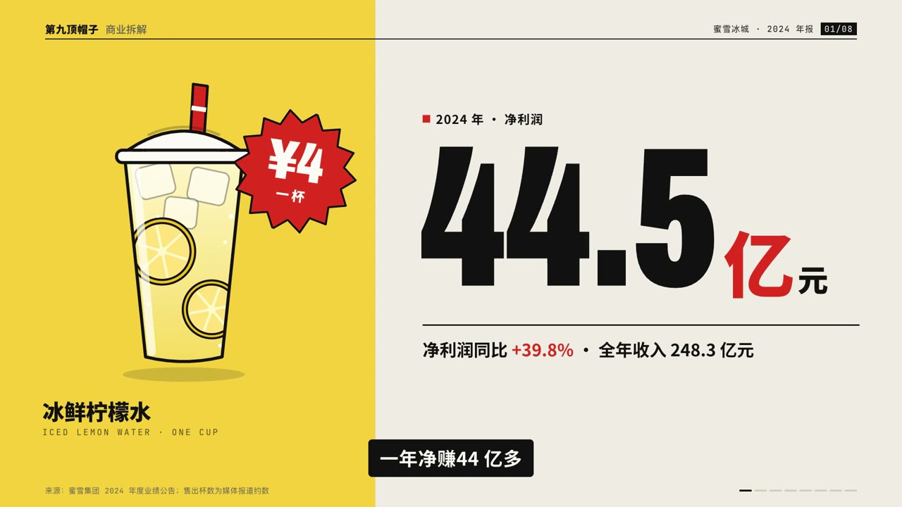</a> | <a href="assets/previews/mixue_9x16.mp4">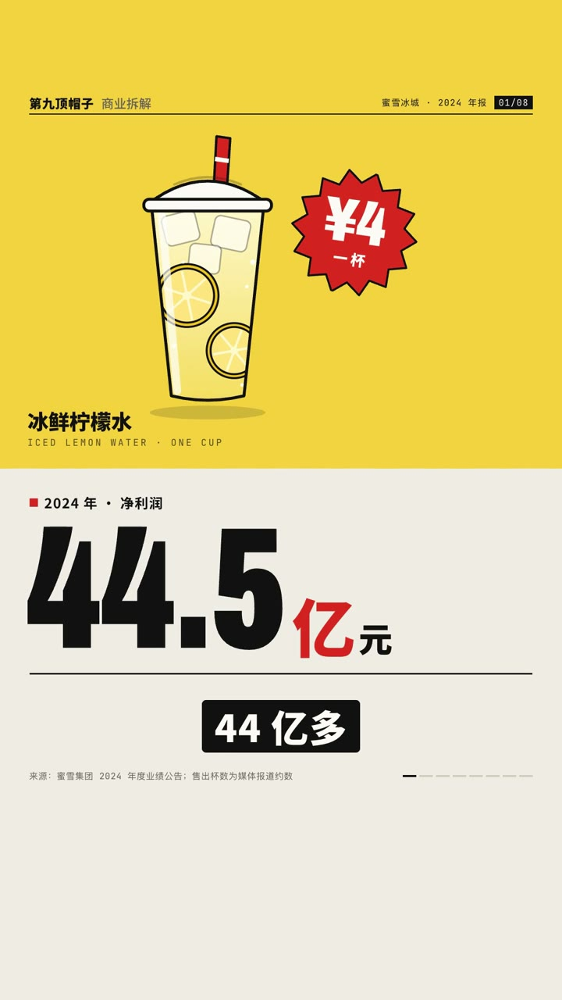</a> | **《一杯 4 块钱的柠檬水》**<br>`press` 财经刊：大字 + 色块，点阵对比、收入构成条一路推进到 2.5%、钱货两条线、飞轮。<br><sub>蜜雪集团 2024 年度业绩公告 · McDonald's 2024 10-K</sub> |
| <a href="assets/previews/screen_16x9.mp4">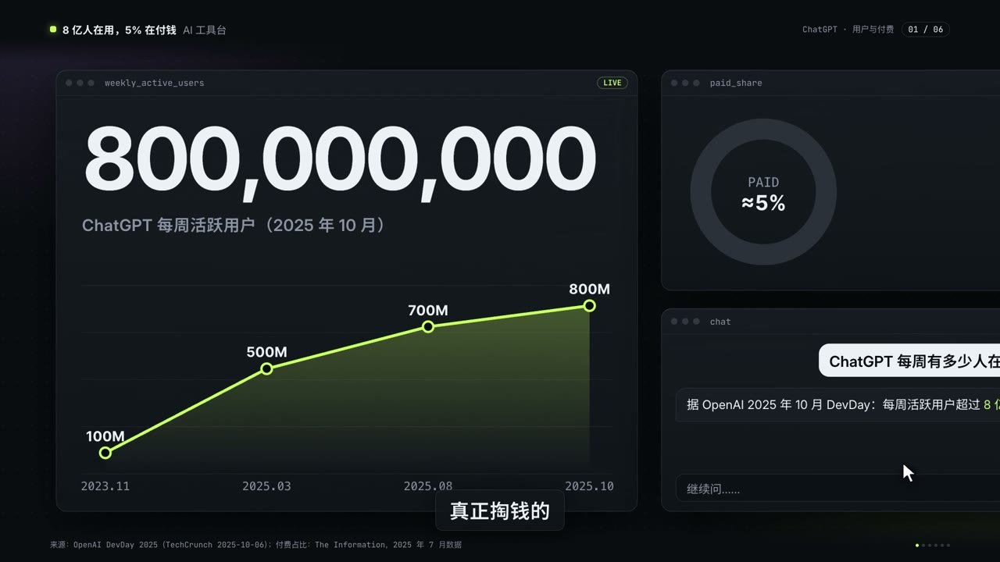</a> | <a href="assets/previews/screen_9x16.mp4">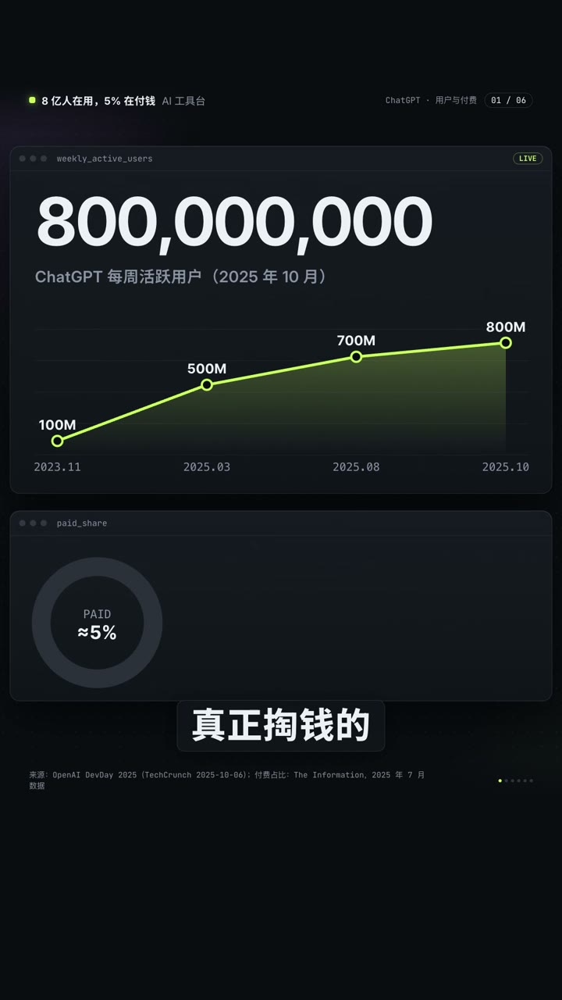</a> | **《8 亿人在用，5% 在付钱》**<br>`screen` AI 工具台：深色产品界面，仪表盘、实时日志计数、定价卡、预测图、⌘K 命令面板，光标真的在点。<br><sub>OpenAI DevDay 2025 · The Information（路透未能核实，画面已标注）· ChatGPT 官方定价</sub> |
| <a href="assets/previews/atlas_16x9.mp4">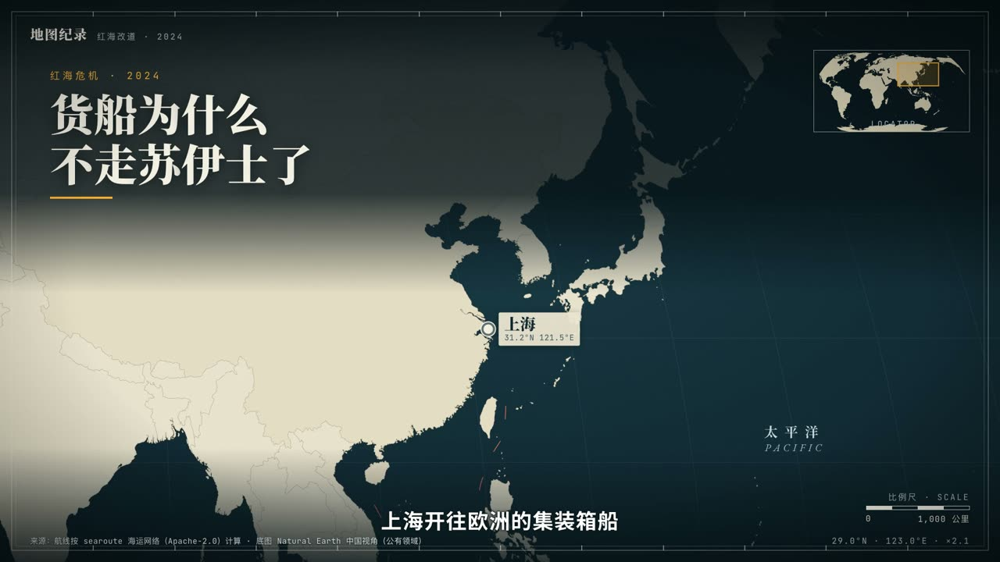</a> | <a href="assets/previews/atlas_9x16.mp4">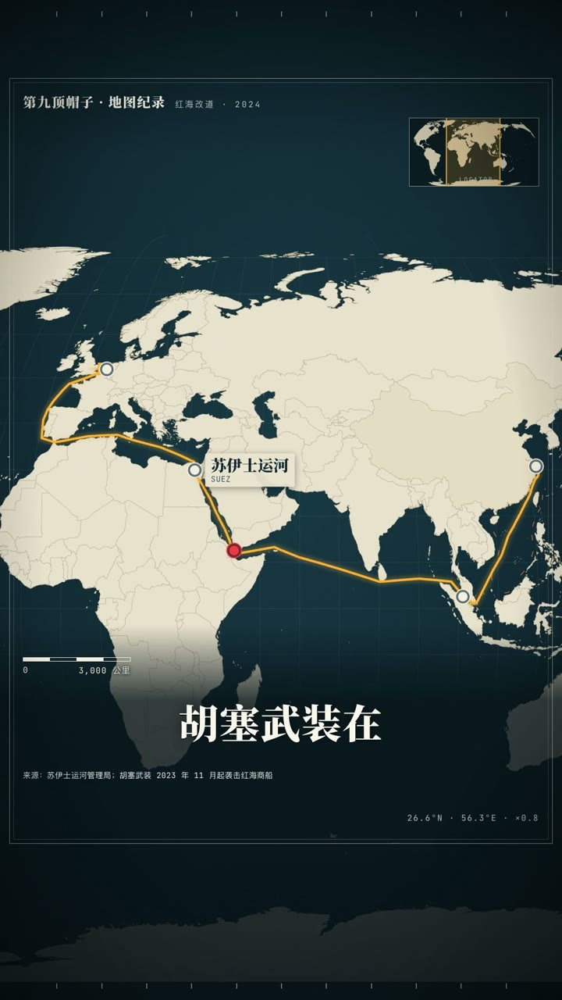</a> | **《货船为什么不走苏伊士了》**<br>`atlas` 地图纪录：一张连续的世界地图，镜头推拉，航线实时绘制、船在走，危险区、运河、运价折线叠在地图上。<br><sub>苏伊士运河管理局 · 世界银行 · Drewry WCI · WEF</sub> |
| <a href="assets/previews/doc_16x9.mp4">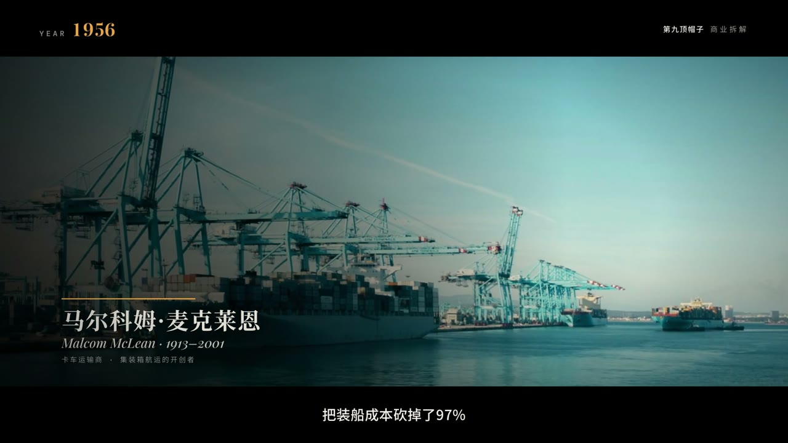</a> | <a href="assets/previews/doc_9x16.mp4">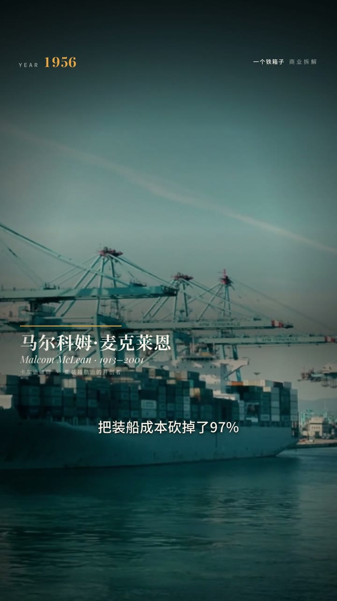</a> | **《一个铁箱子》**<br>`doc` 实拍纪录：2.39 遮幅 + 调色 + 颗粒，1956 档案片接现代港口实拍，年份计数器、数据卡贴在画面上。<br><sub>Levinson《The Box》· 上港集团 2024 快报 · UNCTAD</sub> |
| <a href="assets/previews/poster_16x9.mp4">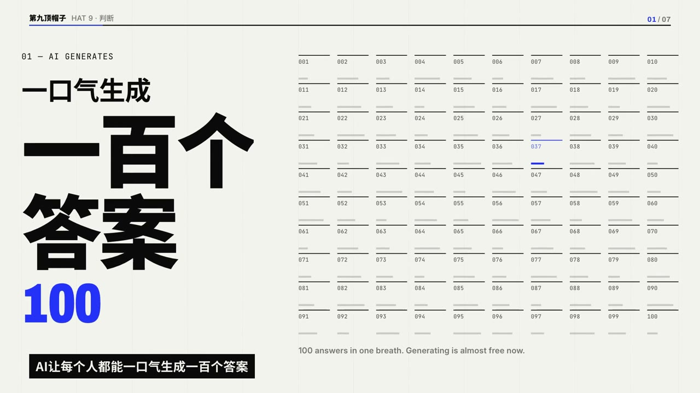</a> | <a href="assets/previews/poster_9x16.mp4">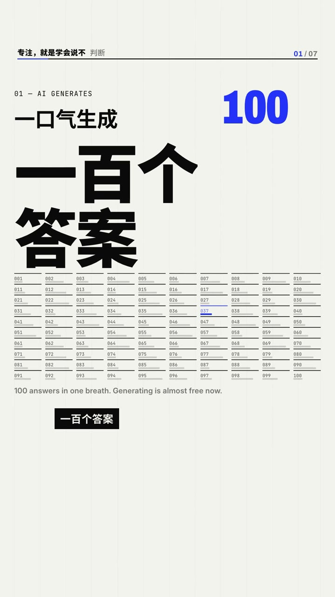</a> | **《专注，就是学会说不》**<br>`poster` 瑞士海报：12 栏网格随每句话重排，黑白 + 一个信号蓝，100 格答案矩阵、24 张图扔到只剩 1 张。<br><sub>Steve Jobs，WWDC 1997 收尾问答</sub> |
| <a href="assets/previews/papercut_16x9.mp4"></a> | <a href="assets/previews/papercut_9x16.mp4">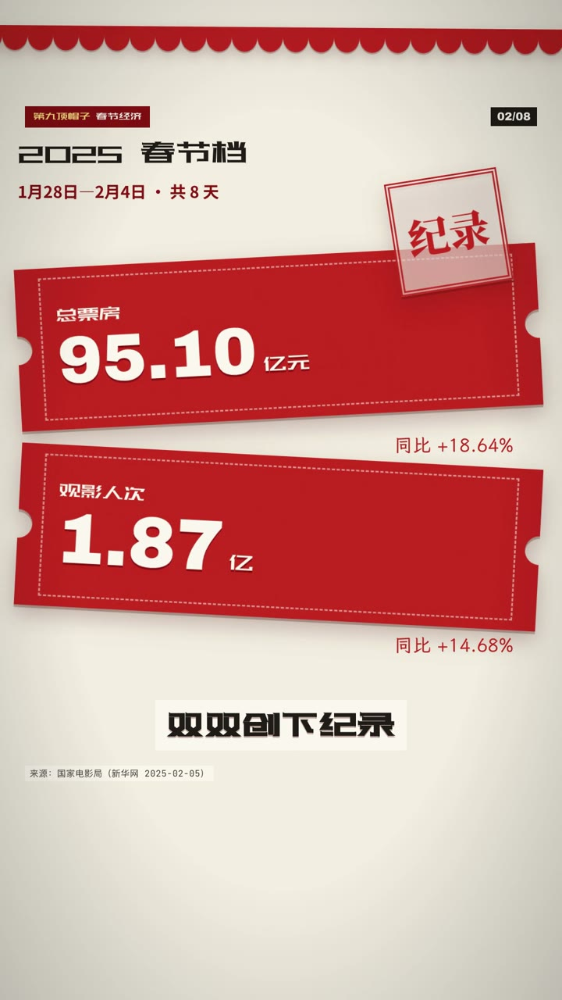</a> | **《过年看电影，钱押给最好的那一部》**<br>`papercut` 剪纸：中国红纸张层层叠，电影票、日历、窗花、灯笼，纸页翻折推入，镜头带纵深视差。<br><sub>国家电影局（新华网 2025-02-05）</sub> |
| <a href="assets/previews/sketch_16x9.mp4">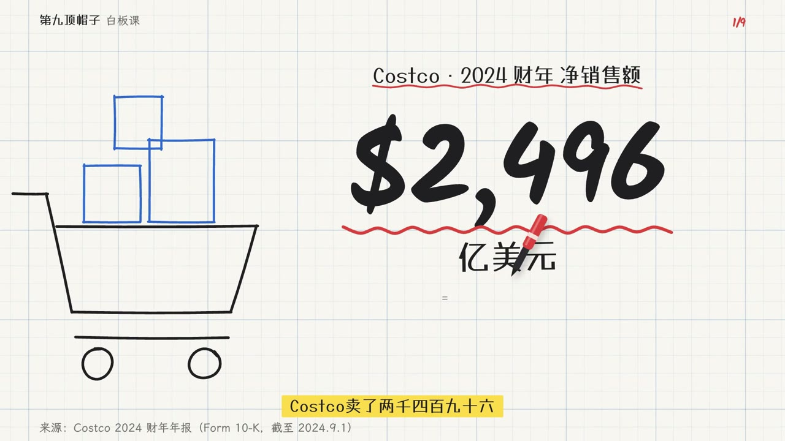</a> | <a href="assets/previews/sketch_9x16.mp4">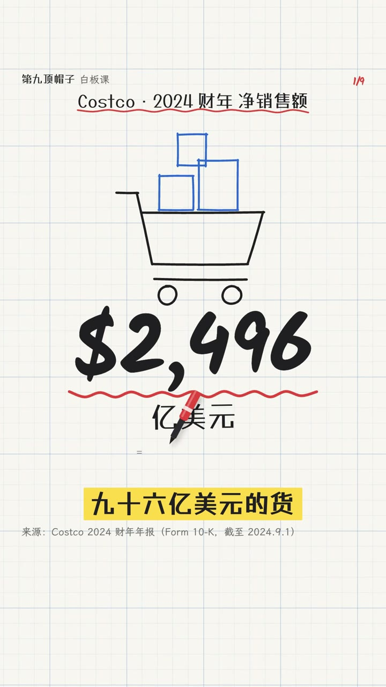</a> | **《Costco 真正卖的是什么》**<br>`sketch` 手绘白板：方格纸上马克笔一笔一笔画出购物车、会员卡、箭头和圈，红笔跟着笔画走，镜头跟笔。<br><sub>Costco 2024 财年年报（Form 10-K）</sub> |
| <a href="assets/previews/ink_16x9.mp4"></a> | <a href="assets/previews/ink_9x16.mp4"></a> | **《一只猴子，三天卖出一千万套》**<br>`ink` 水墨国风：宣纸远山，书法字一笔一笔写出来，墨点人群、挂轴、手卷、对联和印章，墨滴晕开转场。<br><sub>游戏科学官方公告 · VG Insights 估算 · 澎湃新闻 · 界面新闻</sub> |
| <a href="assets/previews/zine_16x9.mp4">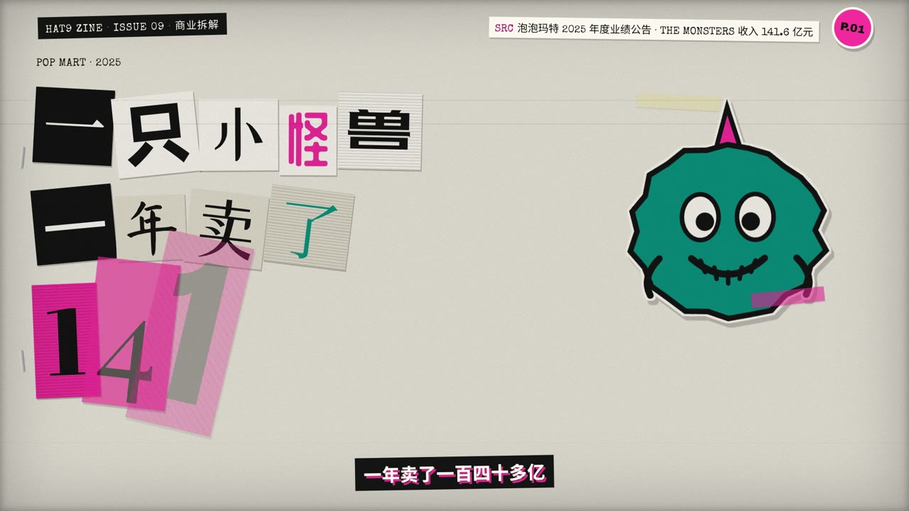</a> | <a href="assets/previews/zine_9x16.mp4"></a> | **《一只怪兽，一年卖了一百四十多亿》**<br>`zine` 拼贴杂志：每个字是一块剪报，粉青黑孔版印刷，胶带、邮票、邮戳、马克笔，逐两帧定格，撕纸换页。<br><sub>泡泡玛特 2024 / 2025 年度业绩公告 · 观察者网</sub> |
| <a href="assets/previews/flat_16x9.mp4"></a> | <a href="assets/previews/flat_9x16.mp4"></a> | **《一份外卖背后的城市网络》**<br>`flat` 扁平插画：夜色城市、骑手人群、跑道、硬币和钱包，挤压回弹、分层视差、色盘转场。<br><sub>商务部研究院《即时零售行业发展报告（2025）》· 美团 2024 社会责任报告 · 王兴内部信</sub> |
| <a href="assets/previews/pixel_16x9.mp4">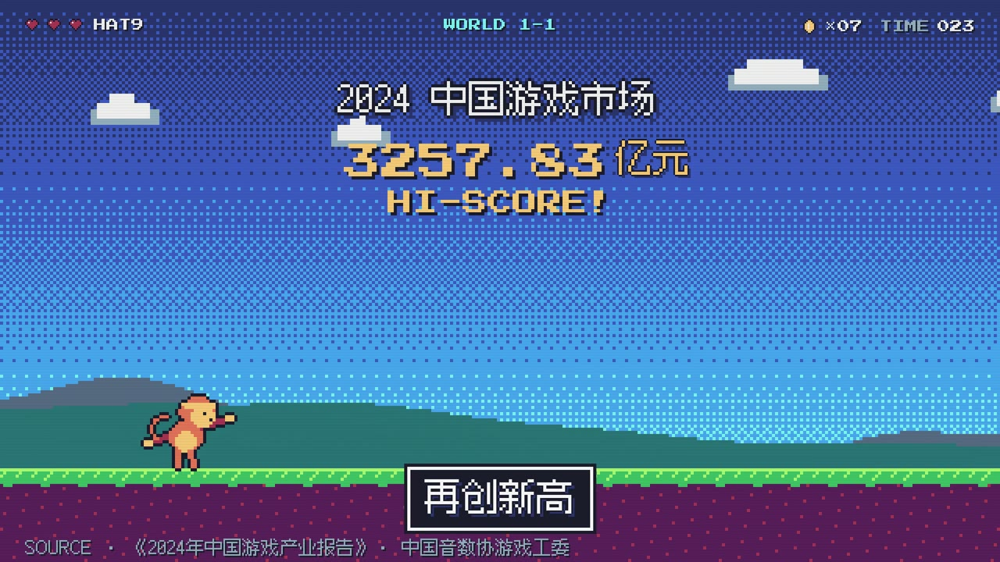</a> | <a href="assets/previews/pixel_9x16.mp4">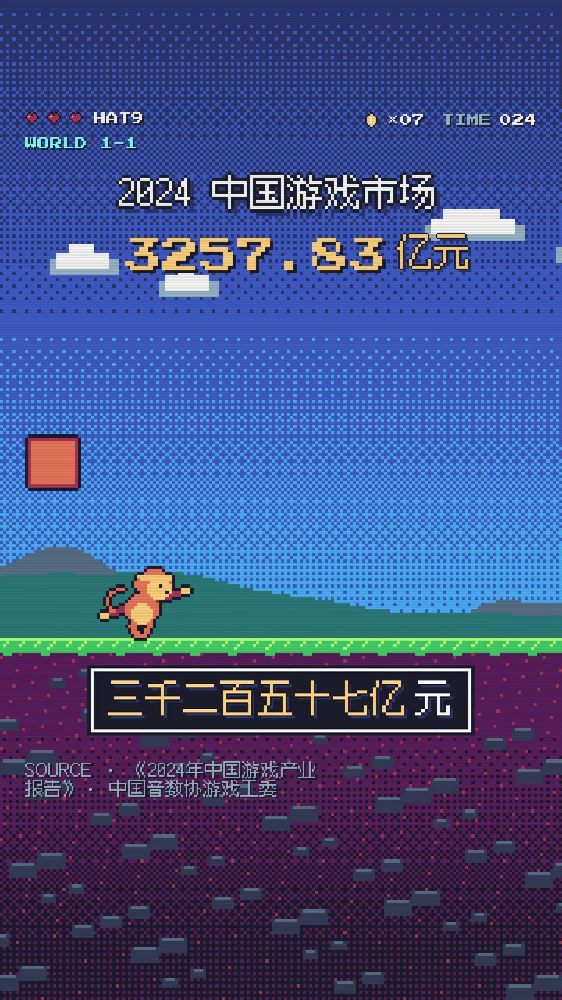</a> | **《三千二百亿的游戏账本》**<br>`pixel` 像素复古：? 砖块顶出 HI-SCORE、宝箱、像素世界地图、像素人群、经验条 LEVEL UP、RPG 对话框，方块溶解转场、芯片音效。<br><sub>《2024年中国游戏产业报告》· 国家统计局</sub> |
| <a href="assets/previews/iso3d_16x9.mp4"></a> | <a href="assets/previews/iso3d_9x16.mp4"></a> | **《快递的规模账》**<br>`iso3d` 等距微缩：一个连续的三维微缩世界，包裹堆成山、城市长出来、柱子升起，镜头跟着包裹走完五站。<br><sub>国家邮政局 2014、2015、2020—2024 年邮政行业发展统计公报</sub> |
| <a href="assets/previews/chrome3d_16x9.mp4">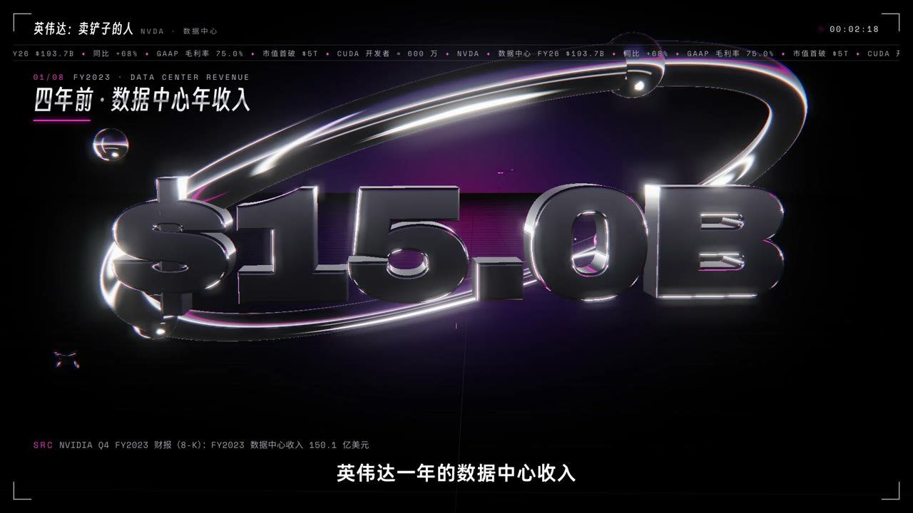</a> | <a href="assets/previews/chrome3d_9x16.mp4"></a> | **《英伟达：卖铲子的人》**<br>`chrome3d` Y2K 镀铬：镀铬立体数字和芯片、霓虹粉光环，在环形门隧道里穿梭换场，$5T、CUDA 上才闪一下。<br><sub>NVIDIA 历年财报（8-K）· Reuters · GTC 2025</sub> |
| <a href="assets/previews/minimal_16x9.mp4">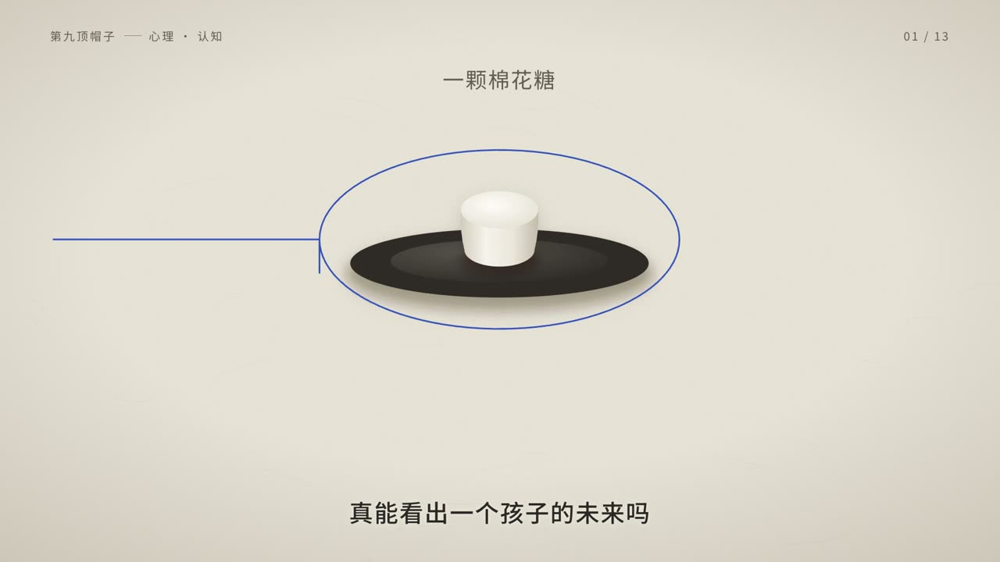</a> | <a href="assets/previews/minimal_9x16.mp4">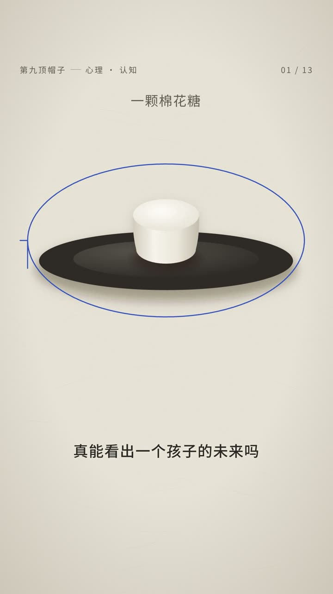</a> | **《棉花糖实验，测的真是自控力吗》**<br>`minimal` 极简讲述：暖白纸上的剪影插画，一条细蓝线贯穿全片，变成地平线、钟面、坐标轴和柱子轮廓，斜体衬线只给一个重音词。<br><sub>Mischel 等 1972 · Shoda 等 1990 · Kidd 等 2013 · Watts 等 2018</sub> |

每条片子就是一份 `video.json`（每句一个场景）加配音，源文件在 [`examples/`](examples/)。

## 什么素材都能放

文字长短、条数多少、图片几张、横的竖的、视频、PDF、网址、表格，都能直接放进去，每种情况都有专门设计过的动效。完整清单和参数范围见 [`references/inputs.md`](references/inputs.md)；所有效果都过了压力测试（`scripts/stress.py`），横竖屏各跑一遍。

**一张图还是两百张，动效不一样**

| | | |
|---|---|---|
| 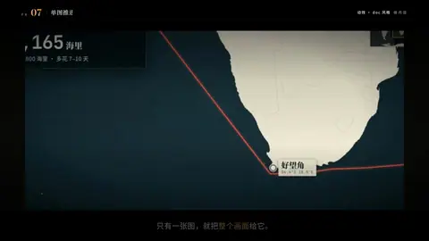<br>**1 张**<br><sub>整屏推进</sub> | 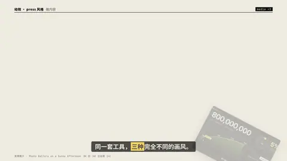<br>**3 张**<br><sub>发牌、扇开、拎出一张</sub> | 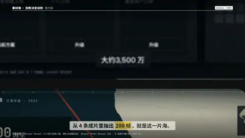<br>**200 张**<br><sub>从一张图拉远成一片海</sub> |

**引用：原文、论文、新闻、原话、视频**

| | | |
|---|---|---|
| 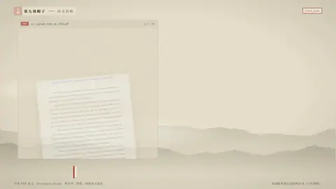<br>**PDF 原文**<br><sub>定位到那一句，记号笔扫过</sub> | 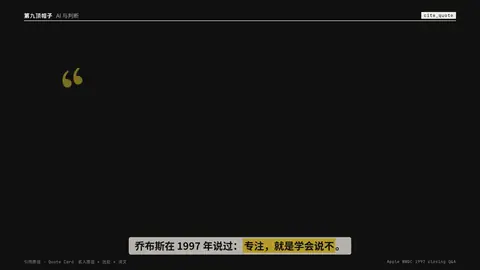<br>**某人说的话**<br><sub>原文 + 译文 + 出处</sub> | 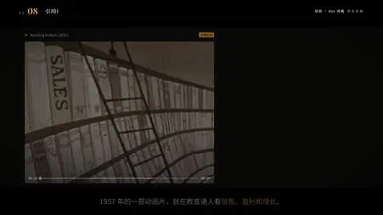<br>**别人的视频**<br><sub>播放器里真实播放 + 时间码</sub> |

**截图、录屏、聊天、评论**

| | | |
|---|---|---|
| 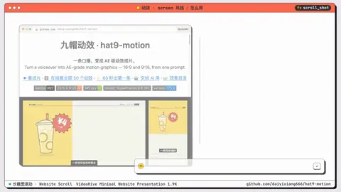<br>**长截图**<br><sub>滚动、在目标处停住高亮</sub> | 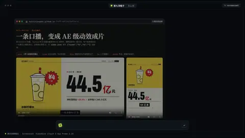<br>**真实录屏**<br><sub>跟着光标推近、点击涟漪</sub> | 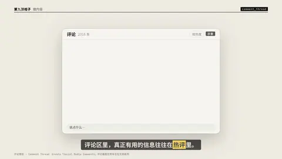<br>**评论区**<br><sub>楼层弹出、热评点亮</sub> |

**数据和表格**

| | | |
|---|---|---|
| 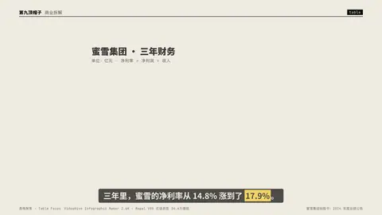<br>**表格**<br><sub>逐格出现、聚焦一行</sub> | 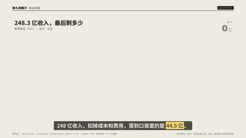<br>**瀑布图**<br><sub>从收入一路扣到净利</sub> | 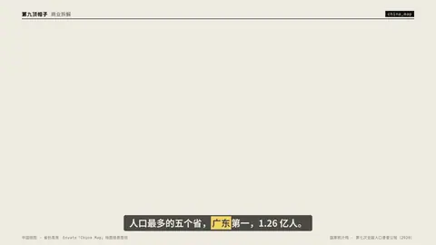<br>**中国地图**<br><sub>分级设色、门店撒点</sub> |

**结构**

| | | |
|---|---|---|
| <br>**要点列表**<br><sub>2 条到 10 条以上都排得开</sub> | 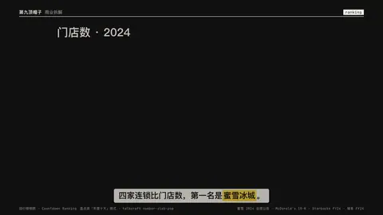<br>**排行榜**<br><sub>倒数揭晓第一名</sub> | 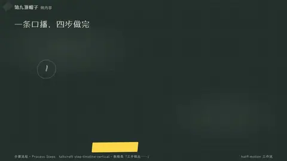<br>**步骤**<br><sub>当前一步高亮</sub> |

**不说话的时候**

| | | |
|---|---|---|
| <br>**留白**<br><sub>金句后停住、画面还在呼吸</sub> | 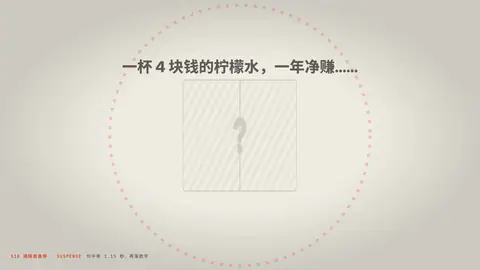<br>**揭晓前悬停**<br><sub>鼓点渐强，数字落在那个词上</sub> | 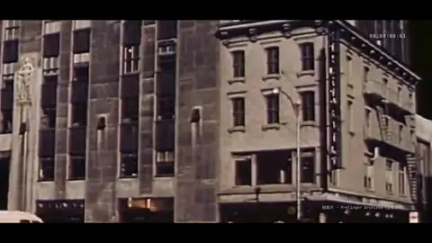<br>**空镜过场**<br><sub>按时长自动挑空镜</sub> |

**视频和声音**

| | | |
|---|---|---|
| <br>**视频定格**<br><sub>停住、压暗、框出细节再继续</sub> | 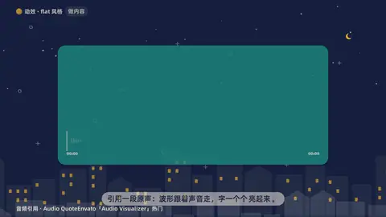<br>**引用一段原声**<br><sub>波形跟着声音跳，字一个个亮</sub> | <br>**主持人画中画**<br><sub>全屏和角落小窗之间切换</sub> |

**文档和图片**

| | | |
|---|---|---|
| 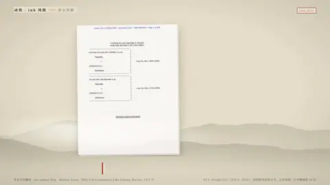<br>**几百页的文档**<br><sub>快速翻到要引用的那一页</sub> | 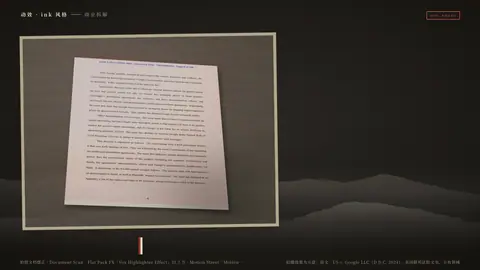<br>**手机拍的文件**<br><sub>自动摆正、划重点</sub> | <br>**Logo 墙**<br><sub>逐个点亮，一个放大</sub> |

**片子类型**

| | | |
|---|---|---|
| 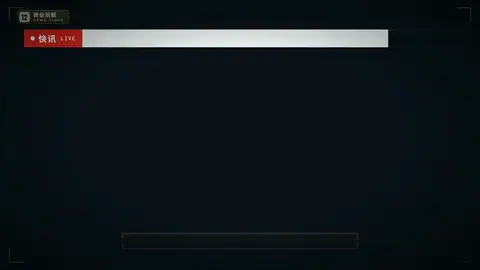<br>**新闻快讯**<br><sub>快讯横幅 + 滚动条</sub> | 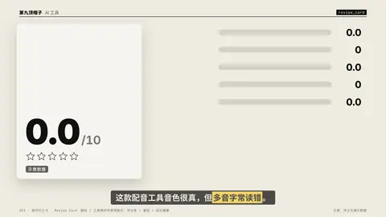<br>**测评**<br><sub>评分条、优缺点、结论章</sub> | 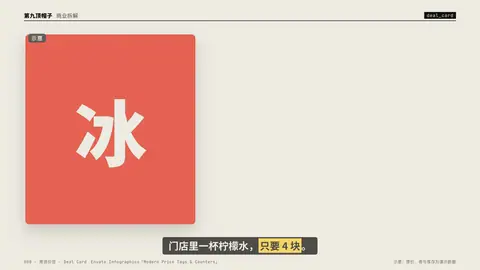<br>**带货**<br><sub>原价划掉、现价砸下</sub> |
全部动效在 [在线画廊](https://daiyixiang666.github.io/hat9-motion/gallery/)，可以按类别筛选、横竖屏切换。

## 你说 → 会发生什么

| 你对 AI 说 | 它会做 |
|---|---|
| 「用 hat9-motion 把这段文案做成竖屏视频：……」 | 拆句分镜 → 每句挑最合适的动效 → 配音 → 字幕 → 出 1080×1920 mp4 |
| 「这是我的录音 voice.wav 和稿子，做成横屏」 | 用你的声音和逐字时间，关键词出现的那一帧画面同时落下 |
| 「第 3 句换成重拍排版，结尾加三连」 | 只改 `video.json` 里对应的两个 beat，重新渲染 |
| 「给这张产品图做个 2.5D 视差开场，标题压在人后面」 | 自动抠出主体、修补背景板，镜头推进，文字夹在两层之间 |
| 「按这个参考视频的节奏做」 | 先拆参考片的句型和剪辑密度，再选对应的效果和转场 |

## 安装

按顺序挑一个就行：

1. **最省事**：直接对你的 AI 助手说「帮我安装这个 skill：`https://github.com/daiyixiang666/hat9-motion`」。
2. **Claude Code 插件**：`claude plugin marketplace add daiyixiang666/hat9-motion`，再 `claude plugin install hat9-motion@hat9-motion`
3. **skills CLI**：`npx skills add daiyixiang666/hat9-motion`
4. **手动**：把仓库放进 `~/.claude/skills/hat9-motion/`（或项目里的 `.claude/skills/`）。
5. **Codex / Cursor / WorkBuddy**：clone 仓库，它们会读根目录的 [`AGENTS.md`](AGENTS.md)。
6. **只能聊天的助手（豆包、DeepSeek 网页版）**：把 Release 里的单文件 `hat9-motion.skill.md` 发给它（`python3 scripts/hat9.py pack` 生成）。

环境自检：

```bash
python3 scripts/hat9.py doctor
```

需要 Python 3.9+、Node.js 22+、FFmpeg；Chrome 由 HyperFrames 第一次渲染时自动下载。可选 `pip install fonttools jieba`（字体子集化更快、字幕按词断行）。

## 60 秒出第一条

```bash
python3 scripts/hat9.py quick "大家都在用 AI。差别不在工具，在判断。百分之九十的人只会多生成几张，再挑一张。" --aspect 9:16
```

3 句文案大约 20 秒出一条竖屏 mp4。想精修就先出分镜再改：

```bash
python3 scripts/hat9.py plan "你的文案" --out work/      # 生成 work/video.json，一句一个 beat
python3 scripts/hat9.py render work/video.json --aspect 16:9 --preview
```

## 动效库：按人气复刻，不是自己编

先统计 VideoHive 销量、YouTube 和 B 站播放量，再逐个用代码复刻（数据见 [`references/ae_popular.md`](references/ae_popular.md)）。每个效果都放在一句真实口播里演示：栏目页眉、整句字幕和关键词，纯文字的页面配主持人形象，所以预览看上去就是成片里的一帧。全部效果、竖屏预览、参数和配方卡在 [在线画廊](https://daiyixiang666.github.io/hat9-motion/gallery/) 和 [`docs/effects.md`](docs/effects.md)。

| 照片 | 字效 | 转场 |
|---|---|---|
| 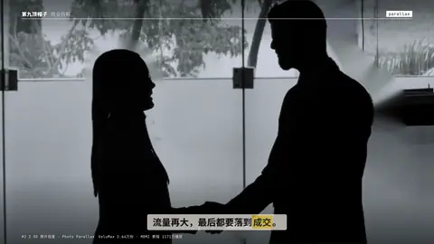<br>**`parallax`** 2.5D 照片视差 · 排名 #2，单条教程 1171 万播放 | 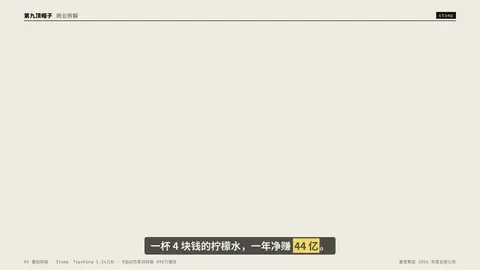<br>**`stomp`** 重拍排版 · #4，B 站动态歌词排版 898 万播放 | 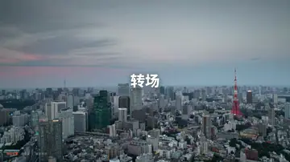<br>**`zoomin`** 无缝缩放 · #1，VideoHive 销量第一 4.16 万份 |
| <br>**`portal`** 瞳孔穿梭 · #10，B 站 364 万播放 | 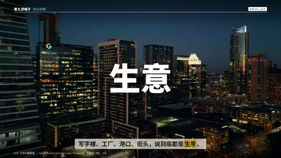<br>**`match_cut`** 文字匹配剪辑 · Envato 标题热门第 1 | 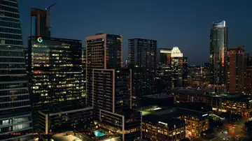<br>**`whip`** 甩镜 · #25，102 万播放 |
| 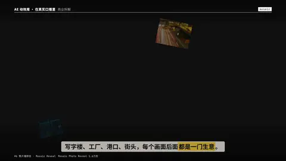<br>**`mosaic`** 照片墙拼合 · #6，1.6 万份 | 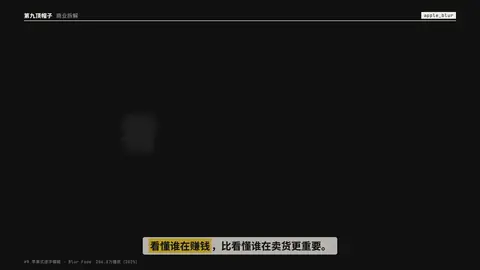<br>**`apple_blur`** 苹果式逐字模糊 · #9，206 万播放 | 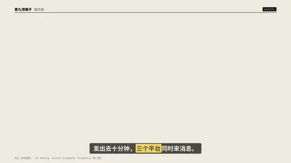<br>**`notify`** 手机通知 · Envato Elements 热门第 1 |

写法就一行：

```json
{"scene": "fx", "fx": "stomp", "words": ["大家", "都在用", "AI"], "t": "@大家"}
```

`"@大家"` 的意思是「口播说出『大家』的那一刻」——动作会提前 2 帧、按缓动的 90% 点落在字上（依据 ITU-R BT.1359 音画同步容忍度）。

## 零 key 能得到什么

| 环节 | 不花钱的默认 | 可以换成 |
|---|---|---|
| 配音 | 系统语音 / 本地 TTS / 静音按字数估时 | 你自己的录音（推荐） |
| 画面 | 174 个代码动效（162 效果 + 12 转场）+ 你的图片、视频、PDF、截图、表格、录音 | 任意生图工具的图片（你自己决定，付费接口会先问你） |
| 音效 | `scripts/sfx.py` 现场合成，19 种 | — |
| 背景音乐 | `scripts/music.py` 现场合成（鼓、贝斯、拨弦、铺底，转场处加重音） | 你自己的授权音乐 |
| 字体 | 思源黑体 / 宋体、得意黑、霞鹜文楷等 OFL 字体 | — |
| 渲染 | HyperFrames 本地逐帧渲染 | — |

## 交付物

| 文件 | 说明 |
|---|---|
| `renders/<style>_9x16.mp4` / `_16x9.mp4` | 1080×1920 / 1920×1080，30 fps，H.264 + AAC |
| `build/<style>_<aspect>/` | 可编辑的 HyperFrames 工程（可在 HyperFrames 桌面版里继续改） |
| `build/.../captions.srt` | 逐句字幕，直接导入剪映 / Premiere |
| `previews/*.mp4` | 1280 / 720 宽的网页预览版 |

## 怎么工作

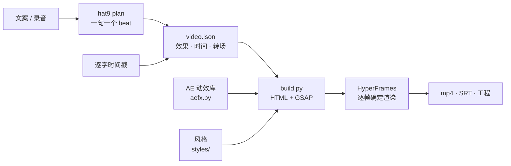

## 目录

```
SKILL.md            给 AI 的入口（路由式）        AGENTS.md / llms.txt   给编码智能体
scripts/hat9.py     命令行：doctor · quick · plan · build · render · fx · styles · pack
scripts/h9/aefx.py  AE 动效库（每个效果一个函数）  scripts/build.py      video.json → HyperFrames 工程
gallery/            在线画廊（index.html · effects.json · llms.txt）
references/effects/ 每个效果一张配方卡             references/           格式、动效规矩、句型→画面、出图规则
styles/             press 财经刊 · screen AI 工具台 · atlas 地图纪录 · doc 实拍纪录 · poster 瑞士海报 · reel 动效库 · hud · studio / clay 三维
examples/           mixue · screen · atlas · doc · poster（5 条成片）· aefx（动效在真实口播里）· stress（素材压力测试）· demo（旧版）
```

## FAQ

<details><summary>这是 AI 生成视频吗？</summary>不是。画面是代码写的动效（HTML + GSAP），由 HyperFrames 逐帧渲染，每次结果完全一样。你可以把任何图片、截图、AI 图放进去当素材。</details>
<details><summary>要会写代码吗？</summary>不用。对 AI 助手说话就行；想自己动手，改 <code>video.json</code> 里的文字和效果名即可。</details>
<details><summary>能用豆包 / DeepSeek 吗？</summary>能执行命令的助手直接用；只能聊天的，把单文件 <code>hat9-motion.skill.md</code> 发给它，它能照着写出 HTML，但渲染要在你自己电脑上跑。</details>
<details><summary>能商用吗？</summary>代码 MIT，可以。字体都是 OFL / Apache；音效是脚本合成的。你放进去的图片和录音，权利归你自己负责。</details>
<details><summary>竖屏会不会被裁？</summary>效果用 vmin 设计，竖屏自动重排；引线标注、瞳孔穿梭这类依赖图片坐标的效果，竖屏要重新给 x / y（配方卡里写了）。</details>
<details><summary>中文字体显示成方块？</summary>运行 <code>doctor</code>：缺字体会告诉你从哪下载、放到 <code>assets/fonts/</code>。</details>
<details><summary>是一键成片吗？</summary><code>quick</code> 能一键出片，但好片子要改分镜：每句话观众看见什么，还是你说了算。</details>

## 许可

- 代码：MIT（[`LICENSE`](LICENSE)）。
- 示例里的实拍空镜来自 Mixkit 免费视频和公有领域档案片，Mixkit 原素材不随仓库分发（见各示例的 `CREDITS.md`）；示例配音为 TTS 合成，背景音乐由 `scripts/music.py` 合成。
- 字体：OFL 1.1 / Apache 2.0；音效：`scripts/sfx.py` 合成，MIT。
- 第三方说明：[`THIRD_PARTY.md`](THIRD_PARTY.md)。对标的创作者和模板只学手法，**不含他们的任何素材、工程文件或预览画面**。
- 本项目免费，谨防倒卖。

## 致谢

学习过这些作品的手法：VideoHive / Envato 的畅销 AE 模板、Animation Composer、Video Copilot、SonduckFilm、Ben Marriott，B 站的 AE 动效作者们；Kurzgesagt、Vox、LEMMiNO、回形针、所长林超、小Lin说；阿杜Next 的 adu-motion-video（MIT）、HeyGen 的 HyperFrames（Apache-2.0）、remotion-dev/skills、video-shotcraft。

## 更新

- **0.15.0** 新参数 `meta.channel`（页眉、落版里的频道名）；示例换成中性的示例频道和代码绘制的主持人。
- **0.14.4** 统一字幕位置不再被风格覆盖；快切 `zoom` 藏掉素材自带字幕。
- **0.14.3** 字幕可以统一样式（`caption_style`），也可以按 beat 关掉（`caption: false`）。
- **0.14.2** 长片可以按章换风格；修正竖屏画面只占上半屏；`frame_fit` 放大填满。
- **0.14.1** 版式示例换成自己的数据；新增「连续大数字」检查。
- **0.14.0** 14 个新版式和数字画面；常驻主体层、章节外框；版式多样性检查。
- **0.13.0** 新风格「极简讲述」；配乐卡拍（片中快切、说话压低、-14 LUFS）；讲产品只用真实界面（ui_capture + ui_lift）；craft_lint 加工作室规矩。
- **0.12.0** 每个导演关卡都有命令：需求单与分镜检查、静帧板、动画小样、卡拍快切、参考板，自检加上声音和打分关。
- **0.11.0** 导演手册和交付前自检：需求单、关卡流程、画面硬规矩，`hat9.py review` 出静帧板并自动挑刺。
- **0.10.0** 自定义风格：从任一风格派生自己的风格，预览、检查、放进画廊。
- **0.9.0** 动效跟着风格换皮：12 种风格各有自己的动效页面（纸张、页眉、字幕、配色）；画廊加了风格墙，每个动效用最合适的风格演示。
- **0.8.1** 新增两款字体：缝合像素（`pixel` 的中文）和霞鹜漫黑（`sketch`、`zine` 的手写）。
- **0.8.0** 新增 8 种风格：剪纸、手绘白板、水墨国风、拼贴杂志、扁平插画、像素复古、等距微缩、Y2K 镀铬，各带一条示例成片；字体扩到 58 款，附字体样张。
- **0.7.0** 再补 58 个效果：视频定格和变速、播客引用、文档翻页、拍照文档、Logo 墙、漏斗、雷达、面积叠加、逐年扩张、测评卡、带货卡、新闻快讯、片头、预告……；交付支持多画幅、平台字幕预设、AI 标识、品牌包、多语言、剪辑软件导出、长片分章渲染。
- **0.6.0** 新增 50 个效果：按数量换编排、引用、结构、数据表格、截图录屏、社交人物、中国地图、不说话的时刻；动效随句长伸缩、多人字幕、录音对齐、封面、插件安装。
- **0.5.0** 新增 `screen` / `atlas` / `doc` / `poster` 四种风格和 10 个动效；素材自适应。
- **0.4.0** 示例重做，新增 `press` 风格和合成配乐。
- **0.3.0** AE 动效库、命令行、在线画廊。
- **0.2.0** 三维引擎。
- **0.1.0** 首个版本。

详见 [`CHANGELOG.md`](CHANGELOG.md)。

