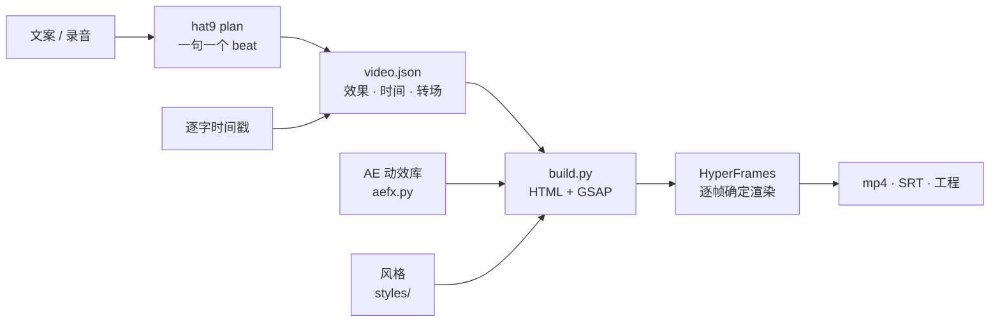

<div align="center">

# 九帽动效 · hat9-motion

**一条口播，变成 AE 级动效成片。**<br>
Turn a voiceover into AE-grade motion graphics — 16:9 and 9:16, from one prompt.

[▶ 看完整示例](#完整示例一杯-4-块钱的柠檬水) · [🎛 在线看全部 40 个动效](https://daiyixiang666.github.io/hat9-motion/gallery/) · [⚡ 60 秒出第一条](#60-秒出第一条) · [🤖 交给 AI 用](#安装) · [📖 效果目录](docs/effects.md)

    

<a href="examples/mixue/video.json"></a>

<sub>示例《一杯 4 块钱的柠檬水》：左横屏、右竖屏，同一份 video.json，各自排版。</sub>

</div>

---

## 完整示例：一杯 4 块钱的柠檬水

一条 31 秒的商业拆解口播，真实数据、真实配音节奏，横竖屏各排一版：

| 横屏 16:9 | 竖屏 9:16 |
|---|---|
| <a href="assets/previews/mixue_16x9.mp4"></a> | <a href="assets/previews/mixue_9x16.mp4"></a> |

- **文案**：9 句，钩子句先给冲突（4 块钱对 44 亿），数据全部来自蜜雪集团 2024 年度业绩公告和 McDonald's 2024 10-K，来源印在每一页的页脚。
- **画面**：`press` 财经刊风格。矢量插画、点阵对比（1 点 = 100 家店）、收入构成条，以及从 2.5% 那一小段一路推进去的镜头、钱和货两条线、飞轮。每页都有镜头调度，没有一秒是静止的。
- **声音**：本地 VoxCPM2 配音（逐字时间戳，画面卡在字上），`scripts/music.py` 现场合成的背景音乐，19 种合成音效。全程零 API key。
- **耗时**：分镜写好后，在 Apple M5 上横屏渲染 23 秒、竖屏 25 秒。源文件：[`examples/mixue/`](examples/mixue/video.json)。

## 你说 → 会发生什么

| 你对 AI 说 | 它会做 |
|---|---|
| 「用 hat9-motion 把这段文案做成竖屏视频：……」 | 拆句分镜 → 每句挑最合适的动效 → 配音 → 字幕 → 出 1080×1920 mp4 |
| 「这是我的录音 voice.wav 和稿子，做成横屏」 | 用你的声音和逐字时间，关键词出现的那一帧画面同时落下 |
| 「第 3 句换成重拍排版，结尾加三连」 | 只改 `video.json` 里对应的两个 beat，重新渲染 |
| 「给这张产品图做个 2.5D 视差开场，标题压在人后面」 | 自动抠出主体、修补背景板，镜头推进，文字夹在两层之间 |
| 「按这个参考视频的节奏做」 | 先拆参考片的句型和剪辑密度，再选对应的效果和转场 |

## 安装

按顺序挑一个就行：

1. **最省事**：直接对你的 AI 助手说「帮我安装这个 skill：`https://github.com/daiyixiang666/hat9-motion`」。
2. **skills CLI**：`npx skills add daiyixiang666/hat9-motion`
3. **Claude Code**：把仓库放进 `~/.claude/skills/hat9-motion/`（或项目里的 `.claude/skills/`）。
4. **Codex / Cursor / WorkBuddy**：clone 仓库，它们会读根目录的 [`AGENTS.md`](AGENTS.md)。
5. **只能聊天的助手（豆包、DeepSeek 网页版）**：把 Release 里的单文件 `hat9-motion.skill.md` 发给它（`python3 scripts/hat9.py pack` 生成）。

环境自检：

```bash
python3 scripts/hat9.py doctor
```

需要 Python 3.9+、Node.js 22+、FFmpeg；Chrome 由 HyperFrames 第一次渲染时自动下载。可选 `pip install fonttools jieba`（字体子集化更快、字幕按词断行）。

## 60 秒出第一条

```bash
python3 scripts/hat9.py quick "大家都在用 AI。差别不在工具，在判断。百分之九十的人只会多生成几张，再挑一张。" --aspect 9:16
```

实测：3 句文案 → 竖屏 mp4，**约 20 秒**（Apple M5，系统语音配音）。想精修就先出分镜再改：

```bash
python3 scripts/hat9.py plan "你的文案" --out work/      # 生成 work/video.json，一句一个 beat
python3 scripts/hat9.py render work/video.json --aspect 16:9 --preview
```

## 动效库：按人气复刻，不是自己编

先统计 VideoHive 销量、YouTube 和 B 站播放量，再逐个用代码复刻（数据见 [`research/ae_popular.md`](research/ae_popular.md)）。每个效果都放在一句真实口播里演示：栏目页眉、整句字幕和关键词，纯文字的页面配柴犬主持人，所以预览看上去就是成片里的一帧。全部效果、竖屏预览、参数和配方卡在 [在线画廊](https://daiyixiang666.github.io/hat9-motion/gallery/) 和 [`docs/effects.md`](docs/effects.md)。

| 照片 | 字效 | 转场 |
|---|---|---|
| <br>**`parallax`** 2.5D 照片视差 · 排名 #2，单条教程 1171 万播放 | <br>**`stomp`** 重拍排版 · #4，B 站动态歌词排版 898 万播放 | <br>**`zoomin`** 无缝缩放 · #1，VideoHive 销量第一 4.16 万份 |
| <br>**`portal`** 瞳孔穿梭 · #10，B 站 364 万播放 | <br>**`match_cut`** 文字匹配剪辑 · Envato 标题热门第 1 | <br>**`whip`** 甩镜 · #25，102 万播放 |
| <br>**`mosaic`** 照片墙拼合 · #6，1.6 万份 | <br>**`apple_blur`** 苹果式逐字模糊 · #9，206 万播放 | <br>**`notify`** 手机通知 · Envato Elements 热门第 1 |

写法就一行：

```json
{"scene": "fx", "fx": "stomp", "words": ["大家", "都在用", "AI"], "t": "@大家"}
```

`"@大家"` 的意思是「口播说出『大家』的那一刻」——动作会提前 2 帧、按缓动的 90% 点落在字上（依据 ITU-R BT.1359 音画同步容忍度）。

## 零 key 能得到什么

| 环节 | 不花钱的默认 | 可以换成 |
|---|---|---|
| 配音 | macOS 系统语音 / 本地 VoxCPM2 / 静音按字数估时 | 你自己的录音（推荐） |
| 画面 | 40 个代码动效 + 你的图片 | 任意生图工具的图片（你自己决定，付费接口会先问你） |
| 音效 | `scripts/sfx.py` 现场合成，19 种 | — |
| 背景音乐 | `scripts/music.py` 现场合成（鼓、贝斯、拨弦、铺底，转场处加重音） | 你自己的授权音乐 |
| 字体 | 思源黑体 / 宋体、得意黑、霞鹜文楷等 OFL 字体 | — |
| 渲染 | HyperFrames 本地逐帧渲染 | — |

## 交付物

| 文件 | 说明 |
|---|---|
| `renders/<style>_9x16.mp4` / `_16x9.mp4` | 1080×1920 / 1920×1080，30 fps，H.264 + AAC |
| `build/<style>_<aspect>/` | 可编辑的 HyperFrames 工程（可在 HyperFrames 桌面版里继续改） |
| `build/.../captions.srt` | 逐句字幕，直接导入剪映 / Premiere |
| `previews/*.mp4` | 1280 / 720 宽的网页预览版 |

## 怎么工作



## 目录

```
SKILL.md            给 AI 的入口（路由式）        AGENTS.md / llms.txt   给编码智能体
scripts/hat9.py     命令行：doctor · quick · plan · build · render · fx · styles · pack
scripts/h9/aefx.py  AE 动效库（每个效果一个函数）  scripts/build.py      video.json → HyperFrames 工程
gallery/            在线画廊（index.html · effects.json · llms.txt）
references/effects/ 每个效果一张配方卡             references/           格式、动效规矩、句型→画面、出图规则
styles/             press 财经刊 · reel 动效库 · hud 暗场 HUD · studio / clay 三维影棚
examples/           mixue（完整示例）· aefx（动效在真实口播里）· demo / promo（旧版，待重做）
research/           调研：AE 动效人气排名、标杆仓库、国内外口播包装、动效工艺
```

## FAQ

<details><summary>这是 AI 生成视频吗？</summary>不是。画面是代码写的动效（HTML + GSAP），由 HyperFrames 逐帧渲染，每次结果完全一样。你可以把任何图片、截图、AI 图放进去当素材。</details>
<details><summary>要会写代码吗？</summary>不用。对 AI 助手说话就行；想自己动手，改 <code>video.json</code> 里的文字和效果名即可。</details>
<details><summary>能用豆包 / DeepSeek 吗？</summary>能执行命令的助手直接用；只能聊天的，把单文件 <code>hat9-motion.skill.md</code> 发给它，它能照着写出 HTML，但渲染要在你自己电脑上跑。</details>
<details><summary>能商用吗？</summary>代码 MIT，可以。字体都是 OFL / Apache；音效是脚本合成的。你放进去的图片和录音，权利归你自己负责。</details>
<details><summary>竖屏会不会被裁？</summary>效果用 vmin 设计，竖屏自动重排；引线标注、瞳孔穿梭这类依赖图片坐标的效果，竖屏要重新给 x / y（配方卡里写了）。</details>
<details><summary>中文字体显示成方块？</summary>运行 <code>doctor</code>：缺字体会告诉你从哪下载、放到 <code>assets/fonts/</code>。</details>
<details><summary>是一键成片吗？</summary><code>quick</code> 能一键出片，但好片子要改分镜：每句话观众看见什么，还是你说了算。</details>

## 许可

- 代码：MIT（[`LICENSE`](LICENSE)）。
- 完整示例的画面全部是代码矢量绘制；动效库里的实拍空镜截自 Mixkit 免费视频（可商用，但素材本身不随仓库再分发，见 `examples/aefx/assets/broll/CREDITS.md`）；配音由本地 VoxCPM2 合成，背景音乐由 `scripts/music.py` 合成。
- 字体：OFL 1.1 / Apache 2.0；音效：`scripts/sfx.py` 合成，MIT。
- 第三方说明：[`THIRD_PARTY.md`](THIRD_PARTY.md)。对标的创作者和模板只学手法，**不含他们的任何素材、工程文件或预览画面**。
- 本项目免费，谨防倒卖。

## 致谢

学习过这些作品的手法：VideoHive / Envato 的畅销 AE 模板、Animation Composer、Video Copilot、SonduckFilm、Ben Marriott，B 站的 AE 动效作者们；Kurzgesagt、Vox、LEMMiNO、回形针、所长林超、小Lin说；阿杜Next 的 adu-motion-video（MIT）、HeyGen 的 HyperFrames（Apache-2.0）、remotion-dev/skills、video-shotcraft。详见 [`research/`](research/)。

## 更新

- 🆕 **2026-10-31 · 0.4.0** 例子全部重做：完整示例《一杯 4 块钱的柠檬水》（`press` 财经刊风格，横竖屏各自排版，带镜头调度）；动效库的每个效果都换成真实口播里的一页；合成背景音乐。
- **2026-10-31 · 0.3.0** 按人气复刻的 AE 动效库（28 效果 + 12 转场），横竖屏同一套代码；`hat9` 命令行，`quick` 一条命令出片；在线画廊与配方卡；SRT 字幕导出。
- **2026-10-31 · 0.2.0** 三维引擎：从字体轮廓挤出真正的立体中文字；陶土影棚、暗场 HUD 风格；美学方向板。
- **2026-10-31 · 0.1.0** 引擎：video.json → HyperFrames；"@关键词" 对口播；手绘标注；字幕；柴犬主持人。

---

<div align="center"><sub>第九顶帽子 · 大家都在用 AI，结果凭什么是你的</sub></div>
