# 效果目录 · Effects

每个效果都是 `scripts/h9/aefx.py` 里的一个函数，在 `video.json` 里写成一个 beat：

```json
{"scene": "fx", "fx": "stomp", "words": ["大家", "都在用", "AI"], "t": "@大家"}
```

排名和人气依据见 [`research/ae_popular.md`](../research/ae_popular.md)。横屏、竖屏同一套参数。

## 效果

### `parallax` — 2.5D 照片视差 (#2, VoluMax/Photomotion; MDMZ 1171万播放)


clean plate + cut-out subject on separate depths, the camera dollies in so the subject separates from the background; optional title sits BETWEEN the layers. plate | image | video as the ground (+focus); fg optional (a transparent PNG cut-out).

- 参数：`fg`, `focus`, `image`, `plate`, `text`, `video`
- 人气：VoluMax 2.64万份 · MDMZ 教程 1171万播放

### `burst` — 形状元素爆发 (Shape Elements burst)


radial lines + ring + dots fire as the word slams in.

- 参数：—
- 人气：Graphics Pack 2.62万份 · SonduckFilm 321万播放

### `stomp` — 重拍排版 Stomp (#4, TypoKing 1.34万份; B站动态歌词排版 898万)

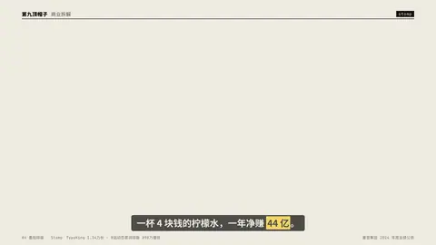

one word per beat slams full-frame, sizes alternate, every third beat inverts the frame; a 2-frame jolt on each hit. words: 1–12 (a list, "a|b|c", or just text → split into words). Long words wrap to two lines. With narration timestamps each word lands the moment it is spoken (like lyric typography).

- 参数：`beat`, `text`, `words`
- 人气：TypoKing 1.34万份 · B站动态歌词排版 898万播放

### `mask_up` — 行遮罩上移 (the most-used title reveal)


each line rises out of its own mask, expo.out.

- 参数：`sub`
- 人气：YouTube 153万 / 145万播放

### `mosaic` — 照片墙拼合 (#6, Mosaic Photo Reveal 1.6万份)

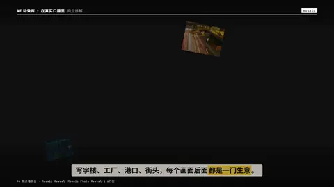

tiles fly in from depth and assemble a wall, then the camera pushes into one tile until it fills the frame. images: 1…24 of any aspect (fewer than 12 → varied crops; 12–24 → one tile each, the grid re-shapes to the count); clips may be mixed in (up to 6 play, the rest show a still).

- 参数：`focus`, `image`, `images`, `video`
- 人气：Mosaic Photo Reveal 1.6万份

### `cartoon` — 卡通冲击特效 (#7, 140 Flash FX 1.47万份)


speed lines, a jagged impact star, smoke puffs — on twos (12 fps steps).

- 参数：`text`
- 人气：140 Flash FX 1.47万份

### `apple_blur` — 苹果式逐字模糊渐显 (#9, 206.8万 2025)

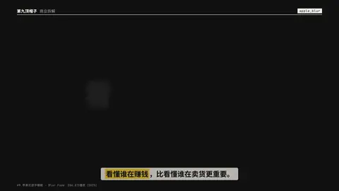

each glyph fades up out of a soft blur and a small rise, grey→white.

- 参数：—
- 人气：206.8万播放（2025）

### `portal` — 瞳孔穿梭 / 穿洞推进 (#10, B站364.5万 2025)


a hole opens on a point of frame A showing frame B, then the camera dives through the hole until B fills the screen. image|video and image2|video2 (+focus, focus2).

- 参数：`focus`, `focus2`, `image`, `image2`, `video`, `video2`, `x`, `y`
- 人气：B站 364.5万播放（2025）

### `shine` — 光泽扫过 (Shine / CC Light Sweep) on a title


a bright band travels across the glyphs once.

- 参数：—
- 人气：Gold Simple Titles 1.1万份

### `neon` — 霓虹点亮 (#12, Neon Sign Kit 1万份)


tube text stutters on (stepped flicker pattern), then holds with a steady glow.

- 参数：`color`
- 人气：Neon Sign Kit 1万份

### `notify` — 手机通知界面 (#13, Envato Elements「Elements」热门第1)

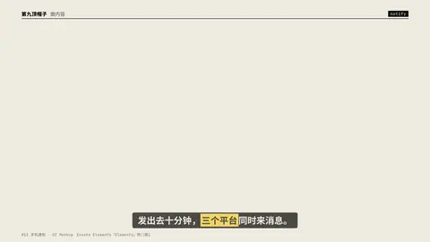

iOS-style banners drop in one after another and stack. items: 1–6 of "应用：消息" | [应用, 消息] | {app, text}; long messages wrap to two lines; the stack scales to fit.

- 参数：`items`, `line`
- 人气：Envato Elements「Elements」热门第1

### `lower3` — 下三分之一字条 (#14, Lower Thirds 第1名 6.3K)


accent bar grows, name slides out of a mask, role follows.

- 参数：`sub`, `text`
- 人气：Lower Thirds 第1名 6.3K份

### `glitch` — 故障 RGB 分离 (Glitch / RGB split)


red & cyan copies jitter on stepped frames, then lock.

- 参数：`text`
- 人气：Video Copilot 198万播放

### `triple` — 三连 (like · coin · favourite …)


1–5 icons pop in sequence, each with a ring burst; the B站/抖音 staple ending. labels: list of 1–5 (icons in order: 点赞 投币 收藏 转发 评论); icons: optional indices into that set.

- 参数：`icons`, `labels`
- 人气：555 Animated Icons 6.4K份 · B站三连 157万

### `callout` — 标注引线 (Callout title)


a dot pops on the subject, the leader line draws out, the label slides along it. image | video (+focus) as the ground; one point (x, y, text, sub) or points: [{x, y, text, sub}, …] up to 4. Labels turn left when the point is on the right third, and drop below when it is near the top.

- 参数：`focus`, `image`, `points`, `sub`, `text`, `video`, `x`, `y`
- 人气：Call-Out Titles 4.5K份

### `odometer` — 数字滚轮 (Odometer / number wheel)


each digit column spins down to its value, staggered. value: 46479 | "46,479" | -3.5 | "97.5" | 1.2e9 (numbers get thousands separators; zh:true → 万/亿).

- 参数：`unit`, `value`, `zh`
- 人气：YouTube 162.6万播放

### `collage` — 拼贴剪纸 (#21, Fakeplastictree Collage 203.5万)


torn-edge photo pieces land on paper on twos, tape, a hand-drawn arrow. images: 1–9 of any aspect (each piece keeps its picture's shape; clips play inside their frames); text: the handwritten note.

- 参数：`focus`, `image`, `images`, `text`, `video`
- 人气：Fakeplastictree 203.5万播放

### `write_on` — 描边书写 → 填色 (Trim Paths on text / 手写签名)


glyph outlines draw on, then the fill floods in.

- 参数：`text`
- 人气：YouTube 128.5万 / 123.7万播放

### `match_cut` — 文字匹配剪辑 Text Match Cut (#23, Envato Elements 标题热门第1/2)


the word holds its exact place while everything around it hard-cuts — background, colour field and typeface change every few frames. Each cut is a designed pair (ground + type treatment), so the word always reads. images: 0…N (all are cycled; clips play as grounds).

- 参数：`focus`, `images`, `text`
- 人气：Envato Elements 标题热门第1、2名

### `impact` — 冲击抖动 (#24, Bricks 106.8万 2025)


the title slams in and the whole frame takes a decaying camera shake.

- 参数：—
- 人气：Bricks 106.8万播放（2025）

### `typewriter` — 打字机 + 光标


one glyph per 2 frames, blinking caret (deterministic blink on the timeline).

- 参数：`text`
- 人气：T5 · 科技 / 教程类必备

### `scramble` — 乱码解码 (Decoder / Scramble)


every slot is a reel of random glyphs that steps (not slides) onto its real character, slots settling left→right. Pure transforms with a steps() ease, so it seeks in any order.

- 参数：`pool`, `text`
- 人气：科技类标题高频

### `tracking` — 字距收拢 (Tracking In)


glyphs start spread wide and drift together while sharpening — done with transforms (x offset ∝ distance from the centre of its own line), so it never snaps to whole pixels like letter-spacing would.

- 参数：`spread`
- 人气：电影片头经典

### `flip3d` — 逐字三维翻转 (3D Flip per character)


rotateX from -100°, transform-origin bottom, perspective on the line.

- 参数：—
- 人气：文字动效合集高频

### `ghost_type` — 巨型虚影背景字 (Ghost / outline background type)


a huge outlined word drifts behind small foreground copy.

- 参数：`ghost`, `text`
- 人气：B站「碰撞吧！」107万播放

### `lockup` — 中英双语锁定 + 注释引线 (type specimen lockup)


headline, latin line, 0–4 leader-line annotations.

- 参数：`notes`
- 人气：B站「碰撞吧！」107万播放

### `diffuse` — 弥散光 (diffuse gradient blobs)


1–5 soft colour blobs orbit slowly behind a calm title.

- 参数：`colors`
- 人气：B站「碰撞吧！」107万播放

### `gooey` — 粘性碰撞 (gooey metaballs)


two balls approach, merge with a liquid neck, bounce apart; squash & stretch. labels: optional [左, 右] — two words that ride under the balls (e.g. 流量 / 供应链).

- 参数：`labels`
- 人气：S5 · B站「碰撞吧！」107万播放

### `earth_zoom` — 

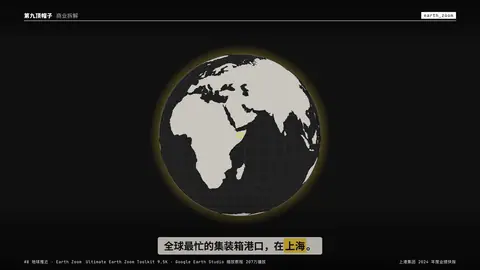


- 参数：`from_lat`, `from_lon`, `km`, `lat`, `lon`, `sub`, `text`, `zoom`
- 人气：Ultimate Earth Zoom Toolkit 9.5K · Google Earth Studio 缩放教程 207万播放

### `map_route` — 

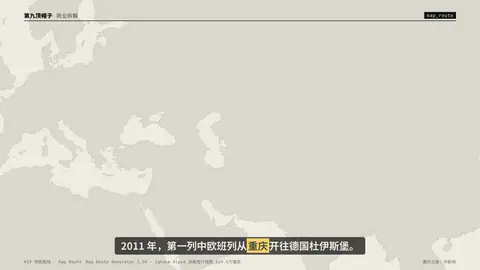


- 参数：`chips`, `from`, `from_sub`, `points`, `stops`, `to`, `to_sub`
- 人气：Map Route Generator 3.5K · Ignace Aleya 动画旅行地图 169.5万播放

### `bars` — 

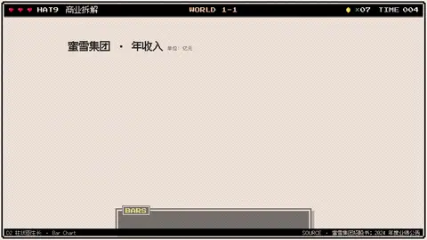


- 参数：`compact`, `dec`, `growth`, `hl`, `items`, `note`, `orient`, `title`, `unit`
- 人气：Infographic Maker 2.6K · Mapal VOX 式信息图 34.6万播放

### `line_draw` — 

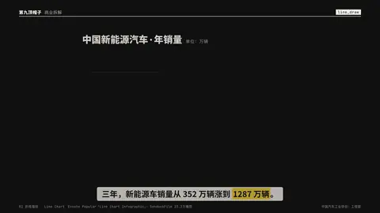


- 参数：`compact`, `dec`, `note`, `points`, `title`, `unit`
- 人气：Envato Popular「Line Chart Infographic」· SonduckFilm 23.2万播放

### `donut` — 


- 参数：`center`, `dec`, `segments`, `sub`, `text`, `value`
- 人气：Envato Popular「Infographic Pie Chart 250+」· Move Shapes 17.6万播放

### `timeline` — 


- 参数：`hl`, `items`
- 人气：Company Timeline 3.2K（Titles 第 9）· Smertimba 23.9万播放

### `chat` — 


- 参数：`a`, `hl`, `placeholder`, `q`, `title`, `turns`
- 人气：Envato Elements「Elements」Popular 第 1 · Text Messages 3.8K

### `hud_lock` — 


- 参数：`image`, `readouts`, `text`, `v`, `video`, `video_start`
- 人气：Quantum HUD Infographic 5.9K（Infographics 第 1）

### `glass` — 

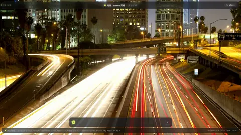


- 参数：`compact`, `dec`, `image`, `kicker`, `rows`, `tag`, `text`, `unit`, `value`, `value_text`, `video`, `video_start`
- 人气：Bricks「Animate Like Apple」76万播放（2025）· Envato「Real Glass FX」Popular 第 4

### `text_mask` — 

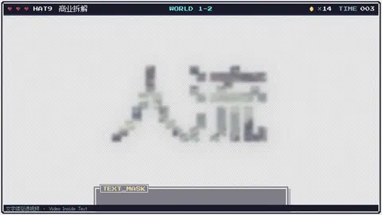


- 参数：`image`, `images`, `sub`, `text`
- 人气：SonduckFilm「5 Quick Text Effects」76.7万播放 · Mixkit Video Mask Title

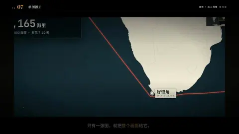 1 张

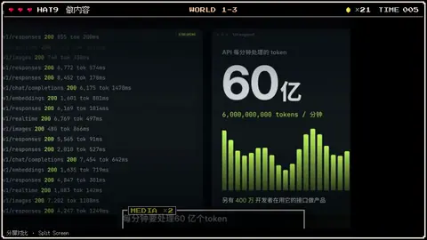 2 张

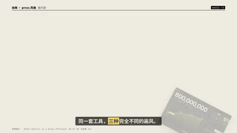 3 张

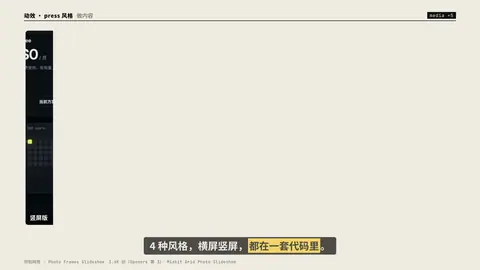 5 张

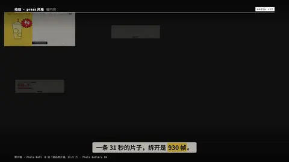 12 张

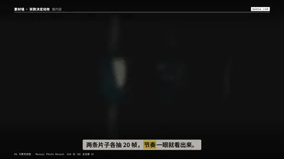 40 张

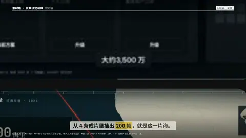 200 张

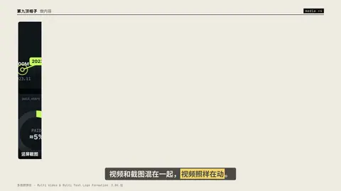 视频混排

### `cite_pdf` — 


- 参数：`cite`, `file`, `kicker`, `page_label`, `pdf`, `quote`, `zh`
- 人气：判决书 / 财报 / 研报原文高亮

### `cite_paper` — 


- 参数：`abstract`, `arxiv`, `authors`, `cites`, `doi`, `figure`, `hl`, `max_authors`, `takeaway`, `title`, `venue`, `year`
- 人气：论文标题页 + 摘要高亮

### `cite_article` — 


- 参数：`box`, `byline`, `date`, `dek`, `excerpt`, `focus`, `headline`, `hl`, `image`, `kicker`, `outlet`, `points`, `section`, `url`
- 人气：「据某某报道」：标题 + 原文摘录 + 要点

### `cite_quote` — 

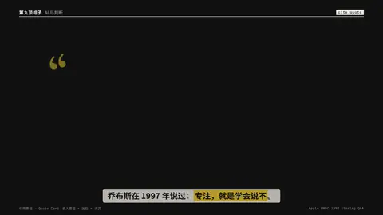


- 参数：`date`, `hl`, `image`, `name`, `role`, `source`, `text`, `year`, `zh`
- 人气：名人原话 + 出处 + 译文

### `cite_post` — 

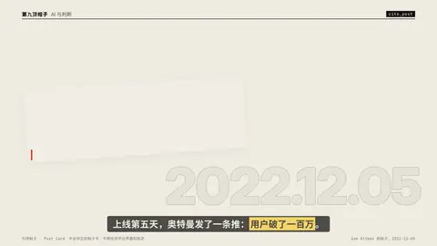


- 参数：`avatar`, `counts`, `date`, `handle`, `hl`, `image`, `name`, `stat`, `text`, `time`, `verified`, `zh`
- 人气：平台中立的帖子卡：不用任何平台界面和标志

### `cite_video` — 


- 参数：`caption`, `focus`, `hl`, `image`, `kicker`, `license`, `quote`, `source`, `start`, `title`, `video`, `year`
- 人气：片段真实播放 · 进度条 · 时间码

### `cite_stack` — 


- 参数：`claim`, `kicker`, `sources`, `tally`
- 人气：交叉验证：每条来源打勾，连线汇到结论

### `list_stack` — 


- 参数：`hl`, `items`, `strike`, `style`, `title`
- 人气：Envato Elements「Checklist Pack」热门 · talkcraft numbered-step-stack

### `steps` — 


- 参数：`hl`, `items`, `title`
- 人气：talkcraft step-timeline-vertical · 教程类「三步做出……」

### `ranking` — 

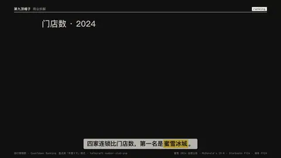


- 参数：`hide_top`, `items`, `title`, `unit`
- 人气：盘点类「年度十大」格式 · talkcraft number-slab-pop

### `term_card` — 

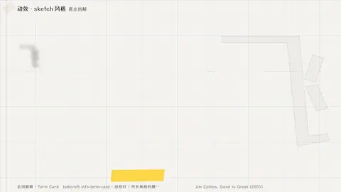


- 参数：`definition`, `example`, `host`, `pos`, `reading`, `source`, `sub`, `term`, `text`
- 人气：talkcraft info-term-card · 回形针 / 所长林超的概念卡

### `word_swap` — 

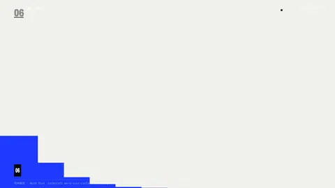


- 参数：`host`, `mode`, `post`, `pre`, `words`
- 人气：talkcraft word-slot-cycle · Rotating Words 标题模板

### `pros_cons` — 

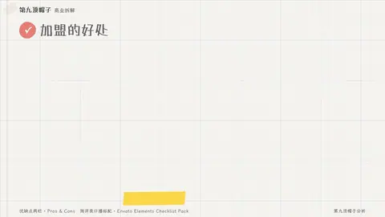


- 参数：`cons`, `labels`, `pros`, `verdict`
- 人气：测评类口播标配 · Envato Elements Checklist Pack

### `quadrant` — 

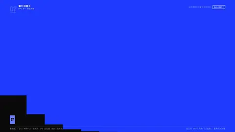


- 参数：`hl`, `items`, `note`, `quads`, `x_axis`, `y_axis`
- 人气：咨询式 2×2 定位图（BCG 矩阵式）

### `countdown` — 


- 参数：`ask`, `from`, `question`, `reveal`, `to`
- 人气：VideoHive Elements countdown 大类 · talkcraft countdown-arc-scatter

### `chapter_bar` — 


- 参数：`chapters`, `hl`, `now`, `title`
- 人气：talkcraft chapter-progress-list · B 站分 P 目录

### `table` — 


- 参数：`compact`, `header`, `hl_cell`, `hl_col`, `hl_row`, `max_rows`, `note`, `paren`, `title`, `transpose`
- 人气：VideoHive Infographic Maker 2.6K · Mapal VOX 式信息图 34.6万播放

### `statement_table` — 

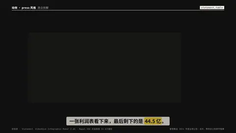


- 参数：`dec`, `hl`, `hl_note`, `period`, `title`, `unit`
- 人气：VideoHive Infographic Maker 2.6K · Mapal VOX 式信息图 34.6万播放

### `waterfall` — 

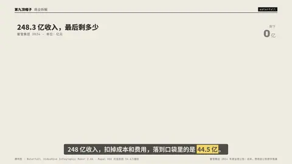


- 参数：`compact`, `dec`, `note`, `orient`, `readout`, `title`, `unit`
- 人气：VideoHive Infographic Maker 2.6K · Mapal VOX 式信息图 34.6万播放

### `scale_compare` — 

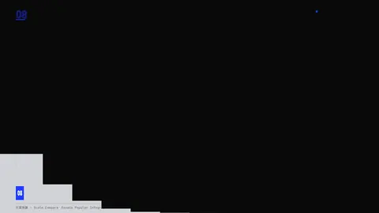


- 参数：`a_label`, `b_label`, `basis`, `dec`, `head`, `icon`, `method`, `mode`, `ratio`, `ratio_label`, `ref_value`, `unit_name`, `value`
- 人气：Envato Popular Infographic · Mapal VOX 式信息图 34.6万播放

### `bar_race` — 

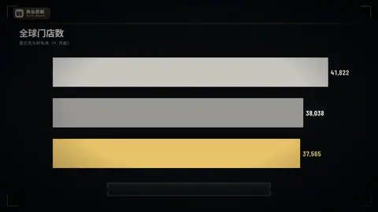


- 参数：`compact`, `csv`, `dec`, `hl`, `note`, `title`, `top`, `transpose`, `unit`
- 人气：Data Is Beautiful 编程语言排行赛跑 上线一个半月 265万播放

### `stacked_bars` — 

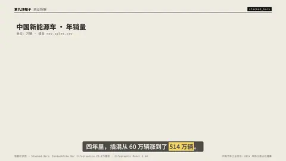


- 参数：`compact`, `csv`, `dec`, `hl`, `note`, `orient`, `percent`, `title`, `total_col`, `totals`, `unit`, `x`
- 人气：SonduckFilm Bar Infographics 23.2万播放 · Infographic Maker 2.6K

### `formula` — 

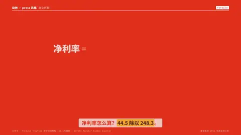


- 参数：`dec`, `lhs`, `note`, `ops`, `result`, `terms`, `unit`
- 人气：YouTube 数字滚动教程 162.6万播放 · Envato Popular Number Counter

### `bars_csv` — 

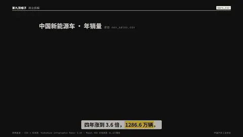


- 参数：`fxid`, `limit`, `scale`, `sort`
- 人气：VideoHive Infographic Maker 2.6K · Mapal VOX 式信息图 34.6万播放

### `scroll_shot` — 


- 参数：`dark_chrome`, `frame`, `image`, `shot`, `tab`, `toc`, `url`
- 人气：VideoHive Minimal Website Presentation 1.9K

### `screencast` — 

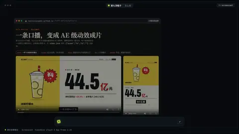


- 参数：`clicks`, `clicks_json`, `cursor`, `dark_chrome`, `frame`, `hl`, `image`, `start`, `steps`, `tab`, `url`, `video`
- 人气：VideoHive iTouch 2 App Promo 2.1K

### `spotlight` — 


- 参数：`boxes`, `dark_chrome`, `dim`, `frame`, `image`, `start`, `url`, `video`, `zoom`
- 人气：VideoHive Explainer Video Toolkit 4 2.5K

### `code` — 

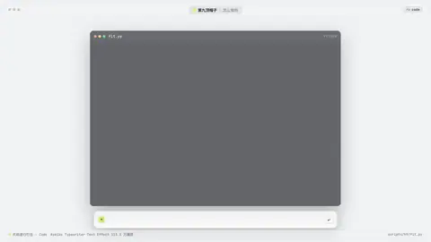


- 参数：`at_hl`, `cmd`, `hl`, `mode`, `output`, `prompt`, `title`
- 人气：Askiko Typewriter Text Effect 113.3 万播放

### `comment_thread` — 


- 参数：`comments`, `hl`, `items`, `mock`, `mock_label`, `placeholder`, `sort`, `text`, `title`, `total`
- 人气：Envato「Social Media Comments」评论截图包常年在社交类前列

### `im_chat` — 


- 参数：`items`, `messages`, `mock`, `mock_label`, `read`, `title`
- 人气：Envato「Text Messages」3.8K 份

### `profile_card` — 


- 参数：`follow`, `hl`, `mock`, `mock_label`
- 人气：Envato「Lower Thirds」6.3K 份 · 社交名片模板

 多人并列

### `equity_tree` — 

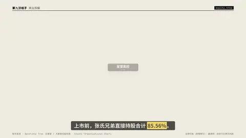


- 参数：`hl`, `holders`, `mock`, `mock_label`, `mode`, `root`, `subs`, `summary`
- 人气：企查查 / 天眼查式股权图 · Envato「Organizational Chart」

### `china_map` — 

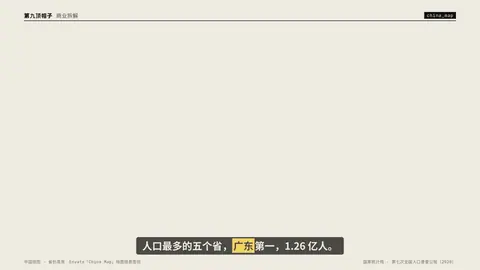


- 参数：`dec`, `dot_unit`, `dots`, `focus`, `highlight`, `hl`, `legend`, `list`, `mock`, `mock_label`, `points`, `seed`, `title`, `top`, `unit`, `values`
- 人气：Envato「China Map」地图信息图包

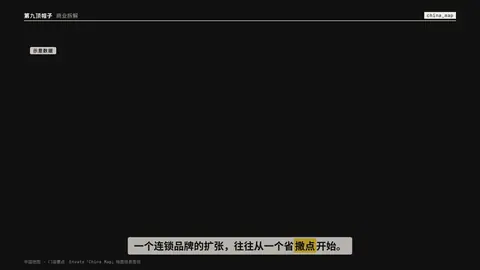 门店撒点

### `danmaku` — 


- 参数：`bg`, `count`, `hl_text`, `items`, `mock`, `mock_label`, `seed`, `speed`, `t_hl`
- 人气：B站弹幕刷屏 · 二创与口播常用

### `receipt` — 

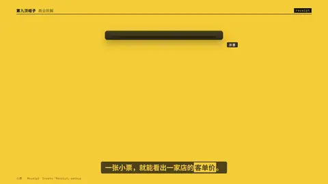


- 参数：`currency`, `discount`, `items`, `mock`, `mock_label`, `no`, `note`, `paid`, `seed`, `store`, `time`, `total`
- 人气：Envato「Receipt」mockup

### `cold_open` — 


- 参数：`clips`, `grade`, `kicker`, `sub`, `title`
- 人气：电影预告 / 纪录片冷开场

### `suspense` — 

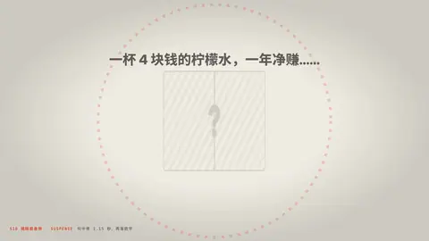


- 参数：`countdown`, `dec`, `q`, `reveal`, `sub`, `unit`, `value`
- 人气：句中停 1.15 秒，再落数字

### `interlude` — 


- 参数：`beats`, `bpm`, `clips`, `grade`, `kicker`, `letterbox`, `source`, `title`
- 人气：不说话的 2.8 秒

### `beat_cut` — 


- 参数：`every`, `items`, `theme`, `ticks`
- 人气：纯音乐 3.6 秒，100 bpm，每拍一切

### `breather` — 


- 参数：`focus`, `held`, `image`, `kicker`, `lift`, `meter`, `mood`, `sub`, `text`, `video`
- 人气：金句后停 2.6 秒

## 转场

写在下一个 beat 上：`"tr": "zoomin"`。

| 转场 | 预览 | 说明 |
|---|---|---|
| `zoomin` |  | #1 无缝缩放 · Seamless Zoom（VideoHive 销量第1 · 4.16万份） |
| `spin` |  | #1 无缝旋转 · Seamless Spin（Motion Bro 免费包 >100万下载） |
| `whip` |  | #25 甩镜 · Whip Pan（SonduckFilm 102.8万播放） |
| `wipe` |  | 色块擦除 · Shape Wipe |
| `bars` |  | 色条 · Bars |
| `iris` |  | 圆形开合 · Iris |
| `glitch` |  | 故障转场 · Glitch（4.5K份） |
| `flash` |  | 闪白 · Flash |
| `leak` |  | 漏光 · Light Leak |
| `burn` |  | 胶片烧 · Film Burn |
| `ink` |  | 墨晕 · Ink |
| `shutter` |  | 快门 · Shutter |
