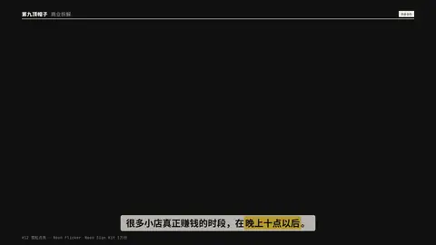
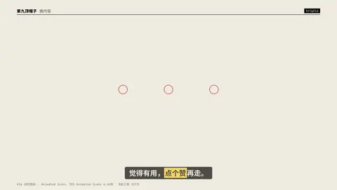
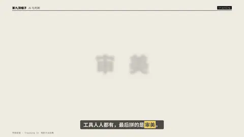
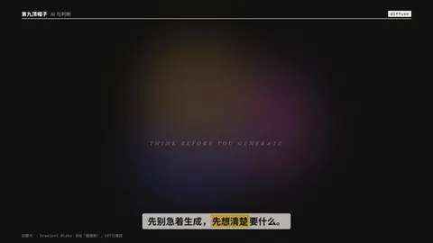
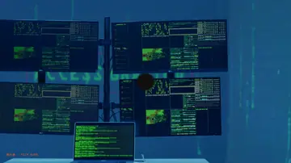

# 效果目录 · Effects

每个效果都是 `scripts/h9/aefx.py` 里的一个函数，在 `video.json` 里写成一个 beat：

```json
{"scene": "fx", "fx": "stomp", "words": ["大家", "都在用", "AI"], "t": "@大家"}
```

排名和人气依据见 [`research/ae_popular.md`](../research/ae_popular.md)。横屏、竖屏同一套参数。

## 效果

### `parallax` — 2.5D 照片视差 (#2, VoluMax/Photomotion; MDMZ 1171万播放)


clean plate + cut-out subject on separate depths, the camera dollies in so the subject separates from the background; optional title sits BETWEEN the layers.

- 参数：`fg`, `plate`, `text`
- 人气：VoluMax 2.64万份 · MDMZ 教程 1171万播放

### `burst` — 形状元素爆发 (Shape Elements burst)


radial lines + ring + dots fire as the word slams in.

- 参数：`text`
- 人气：Graphics Pack 2.62万份 · SonduckFilm 321万播放

### `stomp` — 重拍排版 Stomp (#4, TypoKing 1.34万份; B站动态歌词排版 898万)


one word per beat slams full-frame, sizes alternate, every third beat inverts the frame; a 2-frame jolt on each hit. With narration timestamps each word lands the moment it is spoken (like lyric typography).

- 参数：`beat`, `words`
- 人气：TypoKing 1.34万份 · B站动态歌词排版 898万播放

### `mask_up` — 行遮罩上移 (the most-used title reveal)


each line rises out of its own mask, expo.out.

- 参数：`sub`, `text`
- 人气：YouTube 153万 / 145万播放

### `mosaic` — 照片墙拼合 (#6, Mosaic Photo Reveal 1.6万份)


12 tiles fly in from depth and assemble a wall, then the camera pushes into one tile until it fills the frame.

- 参数：`images`
- 人气：Mosaic Photo Reveal 1.6万份

### `cartoon` — 卡通冲击特效 (#7, 140 Flash FX 1.47万份)


speed lines, a jagged impact star, smoke puffs — on twos (12 fps steps).

- 参数：`text`
- 人气：140 Flash FX 1.47万份

### `apple_blur` — 苹果式逐字模糊渐显 (#9, 206.8万 2025)


each glyph fades up out of a soft blur and a small rise, grey→white.

- 参数：`sub`, `text`
- 人气：206.8万播放（2025）

### `portal` — 瞳孔穿梭 / 穿洞推进 (#10, B站364.5万 2025)


a hole opens on a point of frame A showing frame B, then the camera dives through the hole until B fills the screen.

- 参数：`image`, `image2`, `x`, `y`
- 人气：B站 364.5万播放（2025）

### `shine` — 光泽扫过 (Shine / CC Light Sweep) on a title


a bright band travels across the glyphs once.

- 参数：`text`
- 人气：Gold Simple Titles 1.1万份

### `neon` — 霓虹点亮 (#12, Neon Sign Kit 1万份)



tube text stutters on (stepped flicker pattern), then holds with a steady glow.

- 参数：`color`, `text`
- 人气：Neon Sign Kit 1万份

### `notify` — 手机通知界面 (#13, Envato Elements「Elements」热门第1)


iOS-style banners drop in one after another and stack.

- 参数：`items`
- 人气：Envato Elements「Elements」热门第1

### `lower3` — 下三分之一字条 (#14, Lower Thirds 第1名 6.3K)


accent bar grows, name slides out of a mask, role follows.

- 参数：`sub`, `text`
- 人气：Lower Thirds 第1名 6.3K份

### `glitch` — 故障 RGB 分离 (Glitch / RGB split)


red & cyan copies jitter on stepped frames, then lock.

- 参数：`text`
- 人气：Video Copilot 198万播放

### `triple` — 三连 (like · coin · favourite)



icons pop in sequence, each with a ring burst; the B站/抖音 staple ending.

- 参数：`labels`
- 人气：555 Animated Icons 6.4K份 · B站三连 157万

### `callout` — 标注引线 (Callout title)


a dot pops on the subject, the leader line draws out, the label slides along it.

- 参数：`image`, `sub`, `text`, `x`, `y`
- 人气：Call-Out Titles 4.5K份

### `odometer` — 数字滚轮 (Odometer / number wheel)


each digit column spins down to its value, staggered.

- 参数：`sub`, `unit`, `value`
- 人气：YouTube 162.6万播放

### `collage` — 拼贴剪纸 (#21, Fakeplastictree Collage 203.5万)


torn-edge photo pieces land on paper on twos, tape, a hand-drawn arrow.

- 参数：`images`, `text`
- 人气：Fakeplastictree 203.5万播放

### `write_on` — 描边书写 → 填色 (Trim Paths on text / 手写签名)


glyph outlines draw on, then the fill floods in.

- 参数：`text`
- 人气：YouTube 128.5万 / 123.7万播放

### `match_cut` — 文字匹配剪辑 Text Match Cut (#23, Envato Elements 标题热门第1/2)


the word holds its exact place while everything around it hard-cuts — background, colour field and typeface change every few frames. Each cut is a designed pair (ground + type treatment), so the word always reads.

- 参数：`images`, `text`
- 人气：Envato Elements 标题热门第1、2名

### `impact` — 冲击抖动 (#24, Bricks 106.8万 2025)


the title slams in and the whole frame takes a decaying camera shake.

- 参数：`sub`, `text`
- 人气：Bricks 106.8万播放（2025）

### `typewriter` — 打字机 + 光标


one glyph per 2 frames, blinking caret (deterministic blink on the timeline).

- 参数：`text`
- 人气：T5 · 科技 / 教程类必备

### `scramble` — 乱码解码 (Decoder / Scramble)


every slot is a reel of random glyphs that steps (not slides) onto its real character, slots settling left→right. Pure transforms with a steps() ease, so it seeks in any order.

- 参数：`pool`, `text`
- 人气：科技类标题高频

### `tracking` — 字距收拢 (Tracking In)



glyphs start spread wide and drift together while sharpening — done with transforms (x offset ∝ distance from the centre), so it never snaps to whole pixels like letter-spacing would.

- 参数：`spread`, `sub`, `text`
- 人气：电影片头经典

### `flip3d` — 逐字三维翻转 (3D Flip per character)


rotateX from -100°, transform-origin bottom, perspective on the line.

- 参数：`text`
- 人气：文字动效合集高频

### `ghost_type` — 巨型虚影背景字 (Ghost / outline background type)


a huge outlined word drifts behind small foreground copy.

- 参数：`ghost`, `sub`, `text`
- 人气：B站「碰撞吧！」107万播放

### `lockup` — 中英双语锁定 + 注释引线 (type specimen lockup)


headline, latin line, two leader-line annotations.

- 参数：`notes`, `sub`, `text`
- 人气：B站「碰撞吧！」107万播放

### `diffuse` — 弥散光 (diffuse gradient blobs)



3 soft colour blobs orbit slowly behind a calm title.

- 参数：`colors`, `sub`, `text`
- 人气：B站「碰撞吧！」107万播放

### `gooey` — 粘性碰撞 (gooey metaballs)


two balls approach, merge with a liquid neck, bounce apart; squash & stretch.

- 参数：—
- 人气：S5 · B站「碰撞吧！」107万播放

## 转场

写在下一个 beat 上：`"tr": "zoomin"`。

| 转场 | 预览 | 说明 |
|---|---|---|
| `zoomin` |  | #1 无缝缩放 · Seamless Zoom（VideoHive 销量第1 · 4.16万份） |
| `spin` |  | #1 无缝旋转 · Seamless Spin（Motion Bro 免费包 >100万下载） |
| `whip` |  | #25 甩镜 · Whip Pan（SonduckFilm 102.8万播放） |
| `wipe` |  | 色块擦除 · Shape Wipe |
| `bars` |  | 色条 · Bars |
| `iris` |  | 圆形开合 · Iris |
| `glitch` |  | 故障转场 · Glitch（4.5K份） |
| `flash` |  | 闪白 · Flash |
| `leak` |  | 漏光 · Light Leak |
| `burn` |  | 胶片烧 · Film Burn |
| `ink` |  | 墨晕 · Ink |
| `shutter` |  | 快门 · Shutter |
