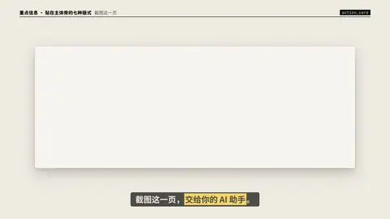

# `action_card` · 截图页

 

**怎么动**：可以截图的结尾页：标题（「截图这一页，交给你的 AI 助手」）、网址打进输入框、2–6 条编号步骤逐条亮起、一排缩略图，最后「截图此页」章落下，画面闪一下，快门角标收拢。

| 项 | 内容 |
|---|---|
| 类别 | 重点信息（贴在主体旁） |
| 适合的句子 | 片尾行动号召：给地址、给步骤、让观众截图 |
| 建议时长 | 5–7 秒 |
| 参数 | `title`、`kicker`、`url`、`label`、`steps`（2–6）、`thumbs`（0–8 张图，没有就画骨架）、`note`、`stamp`（false 不要）、`stamp_at`、`subject` / `video` / `image`（作为圆形头像） |
| 横屏 / 竖屏 | ✓ / ✓（横屏两栏、卡按内容高度居中；竖屏一栏铺满） |
| 跟风格换皮 | 字体、强调色、圆角、描边、阴影、重点词的标法（色块 / 下划线 / 马克笔 / 墨晕）都从风格来（`scripts/h9/fx/_kinfo.py` 的 `SKINS`） |
| 章节底色 | beat 没写 `theme` 时，颜色跟着这一章的 `chapter.bg` 颜色世界走（`scripts/h9/device.py`），深色、浅色、强调色章节都可读；在主持人区域里（`presenter.py`）按区域大小排版 |
| 参考 | 抖音开源竖屏模板宣传片（douyin 7701488753897917723）的同类版式 |

网址太长时输入框里会边打边往左滚；步骤太长先缩字号再省略。

```json
{
 "scene": "fx",
 "fx": "action_card",
 "d": 6.5,
 "theme": "paper",
 "topic": "截图这一页",
 "subject": "../../assets/host.webm",
 "url": "github.com/daiyixiang666/hat9-motion",
 "steps": [
  "打开上面的 GitHub 地址，看清单列出全部效果",
  "选一个喜欢的风格，复制它的 video.json",
  "把你的文案交给 AI，按 SKILL.md 制作",
  "预览确认后导出视频"
 ],
 "thumbs": [
  "../../assets/previews/mixue_9x16.jpg",
  "../../assets/previews/poster_9x16.jpg",
  "../../assets/previews/ink_9x16.jpg",
  "../../assets/previews/zine_9x16.jpg",
  "../../assets/previews/screen_9x16.jpg",
  "../../assets/previews/pixel_9x16.jpg"
 ],
 "note": "本期 *18* 种风格已更新 · 每期视频都附开源地址",
 "line": "截图这一页，*交给你的 AI 助手*。"
}
```
