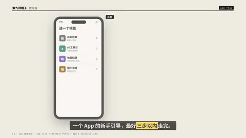
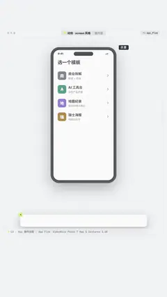

# `app_flow` · 

 

**怎么动**：

| 项 | 内容 |
|---|---|
| 类别 | 界面 |
| 适合的句子 | App 教程、「三步做出……」、新手引导 |
| 建议时长 | 每屏 1.2–1.8 秒（3 屏约 5 秒） |
| 参数 | `dark_chrome`, `flow`, `steps` |
| 横屏 / 竖屏 | ✓ / ✓（尺寸用 vmin，竖屏自动缩放） |
| 人气依据 | VideoHive Phone 7 App & Gestures 2.6K |

```json
{
 "scene": "fx",
 "fx": "app_flow",
 "theme": "paper",
 "topic": "做内容",
 "line": "一个 App 的新手引导，最好*三步以内*走完。",
 "mock": true,
 "screens": [
  {
   "title": "选一个模板",
   "rows": [
    "商业拆解｜数据 + 色块",
    "AI 工具台｜深色产品界面",
    "地图纪录｜航线和镜头推拉",
    "瑞士海报｜网格动态字"
   ],
   "label": "选模板",
   "tap_row": 0
  },
  {
   "title": "粘贴文案",
   "hero": "一杯 4 块钱的柠檬水，一年净赚 44 亿。",
   "rows": [
    "自动分句｜9 句",
    "配音｜本地 TTS"
   ],
   "cta": "生成分镜",
   "label": "粘贴文案"
  },
  {
   "title": "预览",
   "rows": [
    "横屏 16:9｜1920×1080",
    "竖屏 9:16｜1080×1920"
   ],
   "cta": "导出",
   "label": "预览导出"
  }
 ],
 "t": "@关键词"
}
```

**已知坑**：截图和生成页可以混用；tap 是 0–1 的相对坐标；生成页别写真实 App 名字和 logo。
