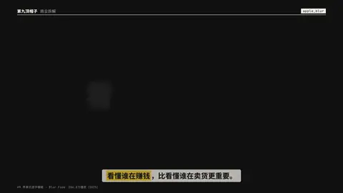

# `apple_blur` · 苹果式逐字模糊渐显 (#9, 206.8万 2025)

 

**怎么动**：each glyph fades up out of a soft blur and a small rise, grey→white.

| 项 | 内容 |
|---|---|
| 类别 | 字效 |
| 适合的句子 | 结论、产品口吻的判断句 |
| 建议时长 | 2–3 秒 |
| 参数 | `sub`, `text` |
| 横屏 / 竖屏 | ✓ / ✓（尺寸用 vmin，竖屏自动缩放） |
| 人气依据 | 206.8万播放（2025） |

```json
{
 "scene": "fx",
 "fx": "apple_blur",
 "theme": "ink",
 "topic": "商业拆解",
 "text": "看懂谁在赚钱",
 "sub": "follow the money",
 "line": "*看懂谁在赚钱*，比看懂谁在卖货更重要。",
 "host": true,
 "t": "@关键词"
}
```

**已知坑**：无
