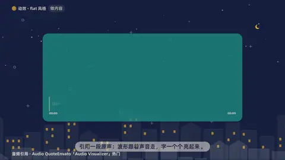

# `audio_quote` · 

 

**怎么动**：

| 项 | 内容 |
|---|---|
| 类别 | 音视频 |
| 适合的句子 | 引用一段原声、某人在节目里说的话 |
| 建议时长 | 跟引用的原声一样长 + 0.8 秒 |
| 参数 | `a`, `audio`, `avatar`, `b`, `bars`, `date`, `kicker`, `quote`, `role`, `source`, `vol`, `who`, `words` |
| 横屏 / 竖屏 | ✓ / ✓（尺寸用 vmin，竖屏自动缩放） |
| 人气依据 | Envato「Audio Visualizer」热门 |

```json
{
 "scene": "fx",
 "fx": "audio_quote",
 "theme": "ink",
 "topic": "做内容",
 "audio": "../mixue/assets/audio/voice.mp3",
 "words": "../mixue/assets/audio/words.json",
 "a": 9.25,
 "b": 14.45,
 "who": "示例频道",
 "role": "旁白 · 原声",
 "source": "《一杯 4 块钱的柠檬水》",
 "date": "00:09–00:14",
 "line": "引用一段原声：波形跟着声音走，字一个个*亮起来*。",
 "t": "@关键词"
}
```

**已知坑**：words.json 必须是这段音频自己的时间戳；没有就写 quote（原话，一字不改）。
