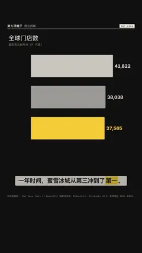

# `bar_race` · 柱状图赛跑

 

**怎么动**：（改进）横条按数值排名，时间往前走、条形伸长、坐标按领先者缩放、互相超车换行，数值在两期之间滚动。9:16 现在条形用满文字安全区，巨大的期数章移到字幕带下面一直铺到底边；口播说出某一期（如「2024 年底」）时该期就在那一刻开始。

| 项 | 内容 |
|---|---|
| 类别 | 数据 |
| 适合的句子 | 排名随时间变化、超车 |
| 建议时长 | 每个时间点 1.5–3 秒 |
| 参数 | `labels` + `series` 或 `csv`（`x`、`transpose`）、`top`、`hl`、`unit`、`dec`、`compact`、`title`、`note` |
| 横屏 / 竖屏 | ✓ / ✓（竖屏：条形在字幕带上方，期数章在下方铺到底边；横屏：期数在右上） |
| 人气依据 | Data Is Beautiful 编程语言排行赛跑 上线一个半月 265万播放 |
| 跟风格换皮 | 颜色只用风格的 token（--bg --fg --muted --accent --card --card-fg），字体用风格的 display / body / num；没写 `theme` 时画在风格自己的底色上 |
| 什么时候用 | 两期以上的排名变化 |
| 什么时候不用 | 只有一期数据（用 ranking） |
| 同步口播 | 有字级时间戳（meta.words）时，条目 / 关键时刻落在说到它的那一刻；`at` 可以写 `"@词"` 或拍内秒数 |
| 缺内容 | 必填参数缺了会直接报错（不会画空骨架）；确实要骨架时写 `"skeleton": true` |

```json
{
 "scene": "fx",
 "fx": "bar_race",
 "topic": "商业拆解",
 "csv": "../data/assets/stores.csv",
 "hl": "蜜雪冰城",
 "title": "全球门店数",
 "note": "星巴克为财年末（9 月底）",
 "unit": "家",
 "line": "一年时间，蜜雪冰城从第三冲到了*第一*。",
 "src": "McDonald's、Starbucks 10-K；蜜雪集团 2024 年度业绩公告",
 "t": "@关键词"
}
```

**已知坑**：不同公司的财年口径要在 note 里写明。
