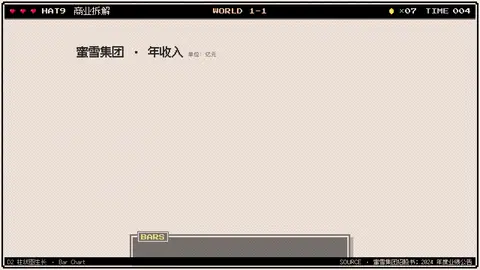
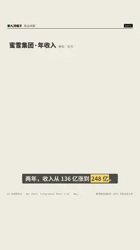

# `bars` · 

 

**怎么动**：

| 项 | 内容 |
|---|---|
| 类别 | 数据 |
| 适合的句子 | 逐年对比、排行、增长 / 下滑 |
| 建议时长 | 3 秒起，每多 5 根 +0.5 秒 |
| 参数 | `compact`, `dec`, `growth`, `hl`, `items`, `note`, `orient`, `title`, `unit` |
| 横屏 / 竖屏 | ✓ / ✓（尺寸用 vmin，竖屏自动缩放） |
| 人气依据 | Infographic Maker 2.6K · Mapal VOX 式信息图 34.6万播放 |

```json
{
 "scene": "fx",
 "fx": "bars",
 "theme": "paper",
 "topic": "商业拆解",
 "items": [
  [
   "2022",
   135.8
  ],
  [
   "2023",
   203.0
  ],
  [
   "2024",
   248.3
  ]
 ],
 "unit": "亿",
 "dec": 1,
 "title": "蜜雪集团 · 年收入",
 "note": "单位：亿元",
 "growth": "+83%",
 "line": "两年，收入从 136 亿涨到 *248 亿*。",
 "src": "蜜雪集团招股书；2024 年度业绩公告",
 "t": "@关键词"
}
```

**已知坑**：超过 10 根（竖屏 7 根）或标签很长时自动改横向；负数挂在零线下方并换浅色；大于 10 万自动换算万 / 亿。
