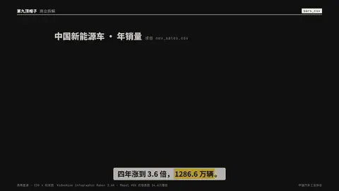
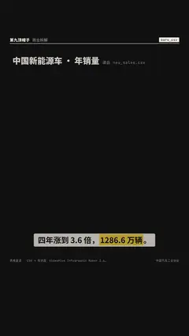

# `bars_csv` · 

 

**怎么动**：

| 项 | 内容 |
|---|---|
| 类别 | 数据 |
| 适合的句子 | 手上只有一张表格 |
| 建议时长 | 2–3 秒 |
| 参数 | `fxid`, `limit`, `scale`, `sort` |
| 横屏 / 竖屏 | ✓ / ✓（尺寸用 vmin，竖屏自动缩放） |
| 人气依据 | VideoHive Infographic Maker 2.6K · Mapal VOX 式信息图 34.6万播放 |

```json
{
 "scene": "fx",
 "fx": "bars_csv",
 "theme": "ink",
 "topic": "商业拆解",
 "csv": "assets/nev_sales.csv",
 "x": "年份",
 "y": "合计",
 "unit": "万辆",
 "dec": 1,
 "title": "中国新能源车 · 年销量",
 "note": "读自 nev_sales.csv",
 "growth": "×3.65",
 "line": "四年涨到 3.6 倍，*1286.6 万辆*。",
 "src": "中国汽车工业协会",
 "t": "@关键词"
}
```

**已知坑**：无
