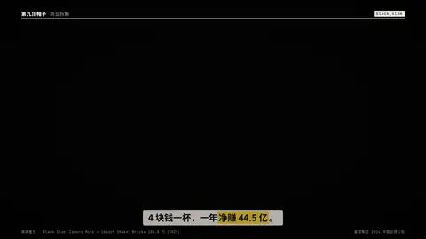

# `black_slam` · 

 

**怎么动**：

| 项 | 内容 |
|---|---|
| 类别 | 字效 |
| 适合的句子 | 最重的一句结论、反转、冲击金句 |
| 建议时长 | 3–4 秒（有 hits 时每词 0.3–0.4 秒） |
| 参数 | `at`, `hits`, `sub`, `text`, `theme` |
| 横屏 / 竖屏 | ✓ / ✓（尺寸用 vmin，竖屏自动缩放） |
| 人气依据 | Camera Move + Impact Shake：Bricks 106.8 万（2025） |

```json
{
 "scene": "fx",
 "fx": "black_slam",
 "theme": "ink",
 "topic": "商业拆解",
 "hits": [
  "4 块钱",
  "一杯"
 ],
 "text": "一年净赚 *44.5 亿*",
 "sub": "一杯柠檬水，只卖 4 块钱",
 "line": "4 块钱一杯，一年*净赚 44.5 亿*。",
 "src": "蜜雪集团 2024 年度业绩公告",
 "t": "@关键词"
}
```

**已知坑**：一条片子用一两次，多了就不重了。
