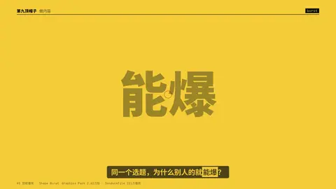
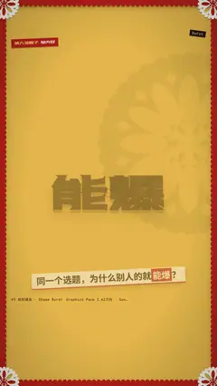

# `burst` · 形状元素爆发 (Shape Elements burst)

 

**怎么动**：radial lines + ring + dots fire as the word slams in.

| 项 | 内容 |
|---|---|
| 类别 | 图形 |
| 适合的句子 | 爆款、数字揭晓、强调 |
| 建议时长 | 2–3 秒 |
| 参数 | — |
| 横屏 / 竖屏 | ✓ / ✓（尺寸用 vmin，竖屏自动缩放） |
| 人气依据 | Graphics Pack 2.62万份 · SonduckFilm 321万播放 |

```json
{
 "scene": "fx",
 "fx": "burst",
 "theme": "lemon",
 "topic": "做内容",
 "text": "能爆",
 "line": "同一个选题，为什么别人的就*能爆*？",
 "host": true,
 "t": "@关键词"
}
```

**已知坑**：无
