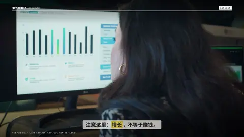

# `callout` · 标注引线 (Callout title)

 

**怎么动**：a dot pops on the subject, the leader line draws out, the label slides along it.

| 项 | 内容 |
|---|---|
| 类别 | 照片 |
| 适合的句子 | 指出图里的细节 |
| 建议时长 | 2–3 秒 |
| 参数 | `image`, `sub`, `text`, `x`, `y` |
| 横屏 / 竖屏 | ✓ / ✓（尺寸用 vmin，竖屏自动缩放） |
| 人气依据 | Call-Out Titles 4.5K份 |

```json
{
 "scene": "fx",
 "fx": "callout",
 "theme": "ink",
 "topic": "商业拆解",
 "image": "assets/broll/charts.jpg",
 "x": 24,
 "y": 36,
 "text": "增长 ≠ 利润",
 "sub": "GROWTH IS NOT PROFIT",
 "line": "注意这里：*增长*，不等于赚钱。",
 "t": "@关键词"
}
```

**已知坑**：竖屏时图片裁切不同，x / y 要按竖屏重新给。
