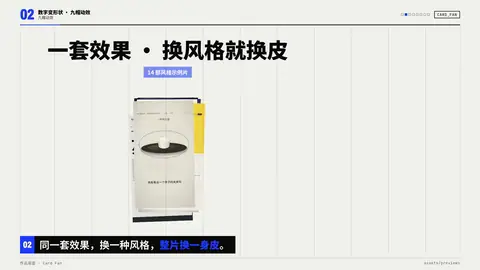

# `card_fan` · 作品扇面 · Card Fan

 

**怎么动**：一叠真实卡片（缩略图、封面、截图）从下面升起，在标题后面扇形展开，带一点 3D 倾斜，每张各自轻轻浮动；中间那张抬起，弹出播放按钮和一圈涟漪。标题和强调色小标签在扇面上方。

**什么时候用**：「看看新做的」「全面升级」「我们的作品」：要一次亮出很多作品又不想做成九宫格时。

| 项 | 内容 |
|---|---|
| 类别 | 数字变形状 |
| 建议时长 | 4.5–5.5 秒 |
| 横屏 / 竖屏 | ✓ / ✓ |

**参数**

| 参数 | 说明 |
|---|---|
| `items / images / folder` | 卡片图（2–15 张，少于 5 张循环；视频取一帧） |
| `title` | 标题 |
| `kicker` | 标题下的小标签 |
| `card_ar` | 卡片宽高比，默认取图片的中位数 |
| `max` | 最多几张，默认 11 |
| `play` | 是否弹出播放按钮，默认 true |
| `subject / subject_label` | 主体小卡 |
| `mock` | 示意标签 |

```json
{
 "scene": "fx",
 "fx": "card_fan",
 "images": [
  "assets/previews/poster_9x16.jpg",
  "assets/previews/ink_9x16.jpg",
  "assets/previews/pixel_9x16.jpg"
 ],
 "title": "一套效果 · 换风格就换皮",
 "kicker": "14 部风格示例片",
 "subject": "../../assets/host.webm",
 "subject_label": "柴柴",
 "line": "同一套效果，换一种风格，*整片换一身皮*。",
 "t": "@关键词"
}
```

所有这一组效果（数字变形状）：颜色、字体、圆角、描边、阴影、入场缓动都取自当前风格（26 种风格自动换皮）；横竖屏同一套参数；可选 `subject`（图片或视频）把主讲人放在旁边的小卡里。

竖屏时横图会裁成竖卡（宽高比 ≤ 0.68），让扇面铺满宽度。

**已知坑**：扇面张开的角度受画面宽度限制；有主体时横屏扇面在左边 2/3。
