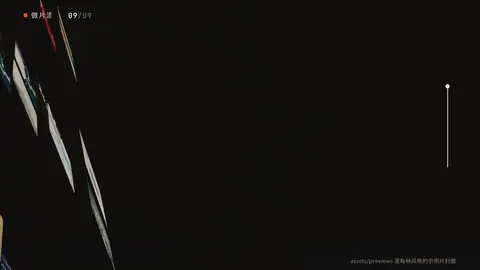
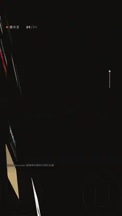

# `card_wall` · 作品墙

 

**怎么动**：一面比画面还大的墙斜躺在三维空间里（横屏前倾 52°、转 −24°；竖屏前倾 46°、转 −16°），上面一排排 16:10 的真实缩略图（圆角 14 px，边框跟风格走）。每一排沿自己的方向以每秒 40 px 漂移，相邻两排方向相反，看起来像一条斜着流过去的作品河。开场时卡片一列一列翻过来（rotateY 90° → 0，每列晚 2 帧）。标题那一侧的墙压到 38% 亮度，并按径向渐渐放开：横屏右边三分之一最亮，竖屏最下面 400 px 只有墙。素材本身很亮（或在浅色风格里很暗）时会自动压得更深，保证标题对比度 ≥ 7:1。写了 `value` 时，大数字从 0 数上去。结尾 0.8 秒墙糊开 24 px、往页面底色里沉，给下一拍的问题腾出位置。

| 项 | 内容 |
|---|---|
| 类别 | 流程 · 媒体 |
| 适合的句子 | 「我做过 300 多条视频」「这个仓库有 197 个效果」：一大堆真实作品当底，上面一句话或一个数 |
| 建议时长 | 4–6 秒 |
| 参数 | `title`（标题，必填；只写 `value` 也行）、`value`（大数字，可选，会数上去；不是数字就直接显示）、`sub`（一行说明）、`media`（图片 / 视频路径列表，6–60 张最好看；少于 6 张按规则重复铺满，超过 60 张均匀抽 60 张；视频取一帧）、`tilt`（`[前倾, 旋转]` 角度）、`resolve`（`"blur"` 默认结尾糊开 / `"none"`） |
| 横屏 / 竖屏 | ✓ / ✓（横屏：标题在左中 x 110 起、约 y 380–620，标题 120–150 px、数字 200 px，从左边擦出，墙整面铺满、右三分之一最亮；竖屏：标题在 y 520–900、x 80 起不超过 880 px 宽，数字 250 px，逐行从下往上冒出，墙更陡并整体缓缓上移，底部 400 px 只有墙） |
| 跟风格换皮 | 压暗用风格的底色（深色风格压暗、浅色风格压淡），标题用风格的前景色和标题字体，数字用强调色（对比度不够时用前景色），卡片边框按风格的线框粗细 |
| 什么时候用 | 讲「量」：作品多、案例多、素材多，要观众一眼看见「一大堆真东西」 |
| 什么时候不用 | 要观众看清某一张图的细节（用 `media` 或 `scroll_shot`） |
| 缺内容 | 没有 `media` 时画风格颜色的占位卡片（一块图位 + 两三行骨架线），不会是空画面；`title` 和 `value` 都没写会报错 |

```json
{
 "scene": "fx",
 "fx": "card_wall",
 "d": 5,
 "media": ["assets/previews/fx/action_card.webp", "assets/previews/fx/app_flow.webp", "…"],
 "value": "197",
 "title": "个动效和转场",
 "sub": "每一个都在画廊里",
 "line": "这个仓库现在有 *197 个*动效和转场。",
 "topic": "效果库"
}
```

**已知坑**：标题一行放不下时先缩到 120 px，再分两行（最小 96 px）、三行（最小 72 px），最后一行才加省略号——标题太长请拆成两拍。只有一两张素材时整面墙都是同一张图，最好给够 6 张以上。

**实现**：`scripts/h9/fx/card_wall.py`。
