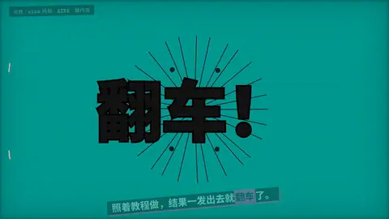

# `cartoon` · 卡通冲击特效 (#7, 140 Flash FX 1.47万份)

 

**怎么动**：speed lines, a jagged impact star, smoke puffs — on twos (12 fps steps).

| 项 | 内容 |
|---|---|
| 类别 | 图形 |
| 适合的句子 | 搞笑、吐槽、意外 |
| 建议时长 | 2–3 秒 |
| 参数 | `text` |
| 横屏 / 竖屏 | ✓ / ✓（尺寸用 vmin，竖屏自动缩放） |
| 人气依据 | 140 Flash FX 1.47万份 |

```json
{
 "scene": "fx",
 "fx": "cartoon",
 "theme": "lemon",
 "topic": "做内容",
 "text": "翻车！",
 "line": "照着教程做，结果一发出去就*翻车*了。",
 "t": "@关键词"
}
```

**已知坑**：无
