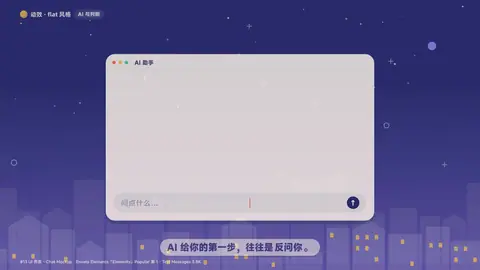

# `chat` · 

 

**怎么动**：

| 项 | 内容 |
|---|---|
| 类别 | 界面 |
| 适合的句子 | 问 AI、对话、提示词演示 |
| 建议时长 | 一问一答 3.5 秒；每多一条 +1 秒 |
| 参数 | `a`, `hl`, `placeholder`, `q`, `title`, `turns` |
| 横屏 / 竖屏 | ✓ / ✓（尺寸用 vmin，竖屏自动缩放） |
| 人气依据 | Envato Elements「Elements」Popular 第 1 · Text Messages 3.8K |

```json
{
 "scene": "fx",
 "fx": "chat",
 "theme": "paper",
 "topic": "AI 与判断",
 "q": "帮我写一份奶茶店开店计划",
 "a": "可以。先回答三个问题：开在哪？卖给谁？一杯赚多少？",
 "hl": "一杯赚多少",
 "line": "AI 给你的第一步，往往是*反问你*。",
 "t": "@关键词"
}
```

**已知坑**：文字太多时字号会缩到 2vmin，再多就让旧消息上滚出窗口。
