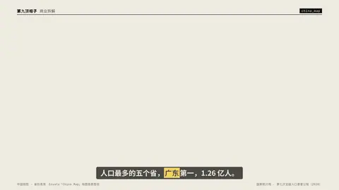

# `china_map` · 

 

**怎么动**：

| 项 | 内容 |
|---|---|
| 类别 | 地图 |
| 适合的句子 | 省份对比、分级设色、门店撒点 |
| 建议时长 | 4–5 秒 |
| 参数 | `dec`, `dot_unit`, `dots`, `focus`, `highlight`, `hl`, `legend`, `list`, `mock`, `mock_label`, `points`, `seed`, `title`, `top`, `unit`, `values` |
| 横屏 / 竖屏 | ✓ / ✓（尺寸用 vmin，竖屏自动缩放） |
| 人气依据 | Envato「China Map」地图信息图包 |

```json
{
 "scene": "fx",
 "fx": "china_map",
 "theme": "paper",
 "topic": "商业拆解",
 "line": "人口最多的五个省，*广东*第一，1.26 亿人。",
 "src": "国家统计局 · 第七次全国人口普查公报（2020）",
 "legend": "常住人口 · 2020 年",
 "unit": " 亿",
 "values": {
  "广东": 1.26,
  "山东": 1.02,
  "河南": 0.99,
  "江苏": 0.85,
  "四川": 0.84
 },
 "dec": 2,
 "hl": "广东",
 "t_hl": 24.0,
 "t": "@关键词"
}
```

**已知坑**：需要中国视角数据和南海诸岛附图（已内置）；各省数据要能引用来源。
