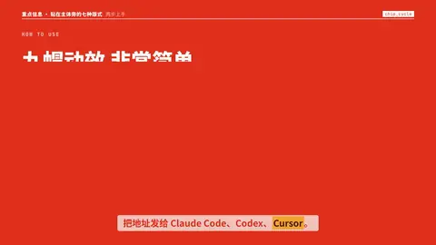

# `chip_cycle` · 步骤 + 标签轮换

 

**怎么动**：编号步骤一条条亮起，挂在某一步下面的一排标签（工具名）里，高亮按 `@词` 一个个跳过去；旁边的窗口标题跟着换成当前标签，主体卡压在窗口一角；最后可以掉进一个文件签。

| 项 | 内容 |
|---|---|
| 类别 | 重点信息（贴在主体旁） |
| 适合的句子 | 「把地址发给 Claude Code、Codex、Cursor」——步骤里有几个可选项 |
| 建议时长 | 4–5 秒（每个标签 ≥ 0.4 秒） |
| 参数 | `title`（`*词*` 套色）、`kicker`、`steps`（1–5）、`chips`（2–8）、`chip_step`、`at`、`chip_at`、`window`、`attach`、`subject` / `video` / `image` |
| 横屏 / 竖屏 | ✓ / ✓（竖屏：步骤和标签占上半屏，窗口 + 主体卡并排占下半屏） |
| 跟风格换皮 | 字体、强调色、圆角、描边、阴影、重点词的标法（色块 / 下划线 / 马克笔 / 墨晕）都从风格来（`scripts/h9/fx/_kinfo.py` 的 `SKINS`） |
| 章节底色 | beat 没写 `theme` 时，颜色跟着这一章的 `chapter.bg` 颜色世界走（`scripts/h9/device.py`），深色、浅色、强调色章节都可读；在主持人区域里（`presenter.py`）按区域大小排版 |
| 参考 | 抖音开源竖屏模板宣传片（douyin 7701488753897917723）的同类版式 |

没有主体时窗口占满右侧 / 下半屏；标签多了自动换第二行。

```json
{
 "scene": "fx",
 "fx": "chip_cycle",
 "d": 5.0,
 "theme": "red",
 "topic": "两步上手",
 "subject": "../../assets/host.webm",
 "kicker": "HOW TO USE · 两步",
 "title": "九帽动效 *非常简单*",
 "steps": [
  "把仓库地址发给 AI 助手",
  "把录音丢给它"
 ],
 "chips": [
  "Claude Code",
  "Codex",
  "Cursor",
  "…等助手"
 ],
 "attach": "hat9-motion",
 "line": "把地址发给 Claude Code、Codex、*Cursor*。"
}
```
