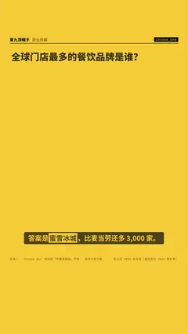

# `choose_one` · 

 

**怎么动**：

| 项 | 内容 |
|---|---|
| 类别 | 结构 |
| 适合的句子 | 选择题、先猜再揭晓 |
| 建议时长 | 4.5–6 秒 |
| 参数 | `dec`, `hops`, `options`, `pick`, `q`, `unit` |
| 横屏 / 竖屏 | ✓ / ✓（尺寸用 vmin，竖屏自动缩放） |
| 人气依据 | 知识区「先猜再揭晓」开场 · 选项卡逐个跳动后落定 |

```json
{
 "scene": "fx",
 "fx": "choose_one",
 "theme": "lemon",
 "topic": "商业拆解",
 "q": "全球门店最多的餐饮品牌是谁？",
 "options": [
  [
   "麦当劳",
   43477
  ],
  [
   "星巴克",
   40199
  ],
  [
   "蜜雪冰城",
   46479
  ],
  [
   "瑞幸咖啡",
   22340
  ]
 ],
 "pick": "蜜雪冰城",
 "unit": "家",
 "line": "答案是*蜜雪冰城*，比麦当劳还多 3,000 家。",
 "src": "各公司 2024 年年报（星巴克为 2024 财年末）",
 "t": "@关键词"
}
```

**已知坑**：无
