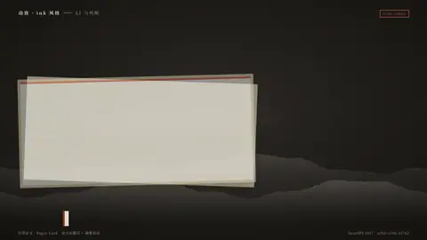
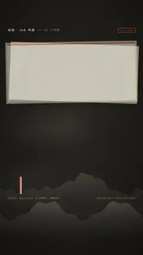

# `cite_paper` · 

 

**怎么动**：

| 项 | 内容 |
|---|---|
| 类别 | 引用 |
| 适合的句子 | 引用论文 |
| 建议时长 | 2–3 秒 |
| 参数 | `abstract`, `arxiv`, `authors`, `cites`, `doi`, `figure`, `hl`, `max_authors`, `takeaway`, `title`, `venue`, `year` |
| 横屏 / 竖屏 | ✓ / ✓（尺寸用 vmin，竖屏自动缩放） |
| 人气依据 | 论文标题页 + 摘要高亮 |

```json
{
 "scene": "fx",
 "fx": "cite_paper",
 "theme": "ink",
 "topic": "AI 与判断",
 "title": "Attention Is All You Need",
 "authors": [
  "Ashish Vaswani",
  "Noam Shazeer",
  "Niki Parmar",
  "Jakob Uszkoreit",
  "Llion Jones",
  "Aidan N. Gomez",
  "Łukasz Kaiser",
  "Illia Polosukhin"
 ],
 "max_authors": 8,
 "venue": "NeurIPS 2017",
 "arxiv": "arXiv:1706.03762",
 "year": 2017,
 "abstract": "We propose a new simple network architecture, the Transformer, based solely on attention mechanisms …",
 "hl": "based solely on attention mechanisms",
 "takeaway": "提出 *Transformer*：只靠注意力机制，不再用循环和卷积",
 "line": "今天的大语言模型，大多建在 2017 年这篇论文提出的 *Transformer* 上。",
 "src": "NeurIPS 2017 · arXiv:1706.03762",
 "t": "@关键词"
}
```

**已知坑**：无
