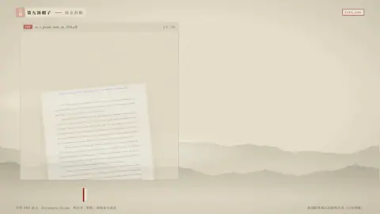
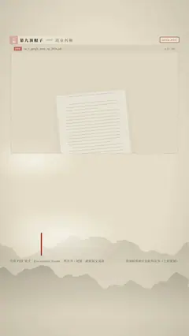

# `cite_pdf` · 

 

**怎么动**：

| 项 | 内容 |
|---|---|
| 类别 | 引用 |
| 适合的句子 | 引用判决书、报告、财报原文 |
| 建议时长 | 4–5 秒 |
| 参数 | `cite`, `file`, `kicker`, `page_label`, `pdf`, `quote`, `zh` |
| 横屏 / 竖屏 | ✓ / ✓（尺寸用 vmin，竖屏自动缩放） |
| 人气依据 | 判决书 / 财报 / 研报原文高亮 |

```json
{
 "scene": "fx",
 "fx": "cite_pdf",
 "theme": "paper",
 "topic": "商业拆解",
 "pdf": "assets/us_v_google_2024_p8.pdf",
 "file": "us_v_google_mem_op_2024.pdf",
 "page_label": "p. 8 / 286",
 "quote": "Google is a monopolist, and it has acted as one to maintain its monopoly.",
 "zh": "谷歌是*垄断者*，而且为了维持垄断，它的所作所为也像一个垄断者。",
 "cite": {
  "title": "United States v. Google LLC",
  "meta": "D.D.C. · No. 20-cv-3010 (APM) · 2024-08-05",
  "page": "Mem. Op. p. 4 · Judge Amit P. Mehta"
 },
 "line": "美国法院 2024 年的判决书里写得很直白：*谷歌是垄断者*。",
 "src": "美国联邦地区法院判决书（公有领域）",
 "t": "@关键词"
}
```

**已知坑**：quote 要和 PDF 里的原文一字不差才能定位；扫描件用 box 手动框。
