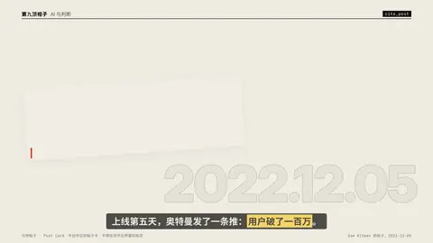

# `cite_post` · 

 

**怎么动**：

| 项 | 内容 |
|---|---|
| 类别 | 引用 |
| 适合的句子 | 引用一条社交帖子 |
| 建议时长 | 2–3 秒 |
| 参数 | `avatar`, `counts`, `date`, `handle`, `hl`, `image`, `name`, `stat`, `text`, `time`, `verified`, `zh` |
| 横屏 / 竖屏 | ✓ / ✓（尺寸用 vmin，竖屏自动缩放） |
| 人气依据 | 平台中立的帖子卡：不用任何平台界面和标志 |

```json
{
 "scene": "fx",
 "fx": "cite_post",
 "theme": "paper",
 "topic": "AI 与判断",
 "name": "Sam Altman",
 "handle": "@sama",
 "text": "ChatGPT launched on wednesday. today it crossed 1 million users!",
 "hl": "crossed 1 million users",
 "time": "2022-12-05",
 "zh": "ChatGPT 周三上线，今天用户突破 *100 万*！",
 "stat": {
  "value": 5,
  "unit": "天",
  "label": "从上线到 100 万用户"
 },
 "line": "上线第五天，奥特曼发了一条推：*用户破了一百万*。",
 "src": "Sam Altman 的帖子，2022-12-05",
 "t": "@关键词"
}
```

**已知坑**：无
