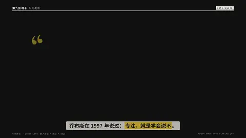

# `cite_quote` · 

 

**怎么动**：

| 项 | 内容 |
|---|---|
| 类别 | 引用 |
| 适合的句子 | 引用某人说过的话 |
| 建议时长 | 2–3 秒 |
| 参数 | `date`, `hl`, `image`, `name`, `role`, `source`, `text`, `year`, `zh` |
| 横屏 / 竖屏 | ✓ / ✓（尺寸用 vmin，竖屏自动缩放） |
| 人气依据 | 名人原话 + 出处 + 译文 |

```json
{
 "scene": "fx",
 "fx": "cite_quote",
 "theme": "ink",
 "topic": "AI 与判断",
 "text": "Focusing is about saying no.",
 "zh": "专注，就是学会说不。",
 "hl": "saying no",
 "name": "Steve Jobs",
 "role": "Apple 联合创始人",
 "source": "WWDC 1997 收尾问答",
 "date": "1997-05-13",
 "line": "乔布斯在 1997 年说过：*专注，就是学会说不*。",
 "src": "Apple WWDC 1997 closing Q&A",
 "t": "@关键词"
}
```

**已知坑**：无
