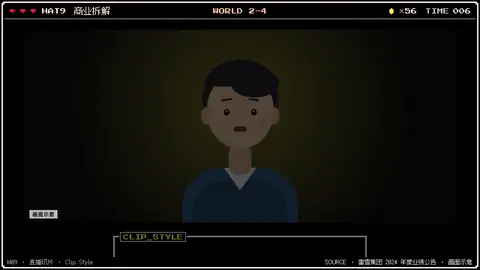
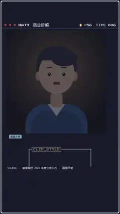

# `clip_style` · 

 

**怎么动**：

| 项 | 内容 |
|---|---|
| 类别 | 类型 |
| 适合的句子 | 直播 / 访谈切片包装 |
| 建议时长 | 跟素材一样长（3–8 秒） |
| 参数 | `comments`, `hearts`, `image`, `line`, `live_text`, `name`, `note`, `quote`, `role`, `time`, `title`, `video`, `viewers` |
| 横屏 / 竖屏 | ✓ / ✓（尺寸用 vmin，竖屏自动缩放） |
| 人气依据 | 直播 / 访谈切片号通用包装 · talkcraft danmu-bubble-praise |

```json
{
 "scene": "fx",
 "fx": "clip_style",
 "theme": "ink",
 "topic": "商业拆解",
 "video": "../mixue/assets/video/shiba.webm",
 "title": "4 块钱的柠檬水凭什么赚 44 亿",
 "name": "柴犬主播",
 "role": "第九顶帽子",
 "time": "12:08",
 "comments": [
  [
   "阿杰",
   "真的假的"
  ],
  [
   "小雨",
   "原来是卖原料"
  ],
  [
   "Tom",
   "学到了"
  ],
  [
   "橙子",
   "下期讲瑞幸"
  ]
 ],
 "note": "画面示意",
 "line": "一杯四块钱的柠檬水，*一年净赚四十四亿*。",
 "src": "蜜雪集团 2024 年度业绩公告 · 画面示意",
 "t": "@关键词"
}
```

**已知坑**：有 line 时本拍的页面字幕被隐藏；不要模仿任何平台的直播界面。
