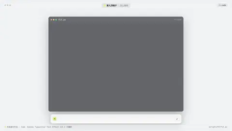
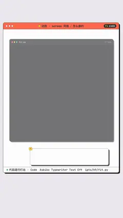

# `code` · 

 

**怎么动**：

| 项 | 内容 |
|---|---|
| 类别 | 屏幕 |
| 适合的句子 | 代码、命令行、改动前后 |
| 建议时长 | 3–6 秒（行多就更长） |
| 参数 | `at_hl`, `cmd`, `hl`, `mode`, `output`, `prompt`, `title` |
| 横屏 / 竖屏 | ✓ / ✓（尺寸用 vmin，竖屏自动缩放） |
| 人气依据 | Askiko Typewriter Text Effect 113.3 万播放 |

```json
{
 "scene": "fx",
 "fx": "code",
 "theme": "paper",
 "topic": "怎么做的",
 "file": "scripts/h9/fit.py#L153-L187",
 "hl": "170-183",
 "line": "放不下时先缩字号、再换行，*实在不行*才加省略号。",
 "src": "scripts/h9/fit.py",
 "t": "@关键词"
}
```

**已知坑**：文件参数叫 file（src 是页脚来源）。
