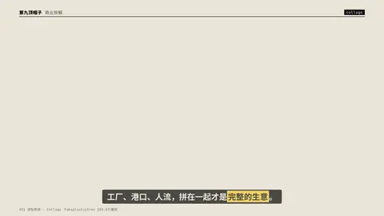
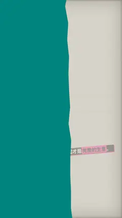

# `collage` · 拼贴剪纸 (#21, Fakeplastictree Collage 203.5万)

 

**怎么动**：torn-edge photo pieces land on paper on twos, tape, a hand-drawn arrow. images: 1–9 of any aspect (each piece keeps its picture's shape); text: the handwritten note.

| 项 | 内容 |
|---|---|
| 类别 | 照片 |
| 适合的句子 | 资料拼贴、证据 |
| 建议时长 | 2–3 秒 |
| 参数 | `focus`, `image`, `images`, `text` |
| 横屏 / 竖屏 | ✓ / ✓（尺寸用 vmin，竖屏自动缩放） |
| 人气依据 | Fakeplastictree 203.5万播放 |

```json
{
 "scene": "fx",
 "fx": "collage",
 "theme": "paper",
 "topic": "商业拆解",
 "images": [
  "assets/broll/factory.jpg",
  "assets/broll/port.jpg",
  "assets/broll/crossing.jpg"
 ],
 "text": "一条供应链",
 "line": "工厂、港口、人流，拼在一起才是*完整的生意*。",
 "t": "@关键词"
}
```

**已知坑**：无
