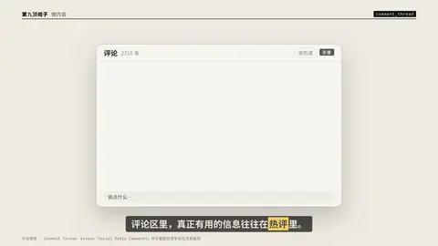

# `comment_thread` · 

 

**怎么动**：

| 项 | 内容 |
|---|---|
| 类别 | 界面 |
| 适合的句子 | 评论区截图、热评 |
| 建议时长 | 3.5–5 秒 |
| 参数 | `comments`, `hl`, `items`, `mock`, `mock_label`, `placeholder`, `sort`, `text`, `title`, `total` |
| 横屏 / 竖屏 | ✓ / ✓（尺寸用 vmin，竖屏自动缩放） |
| 人气依据 | Envato「Social Media Comments」评论截图包常年在社交类前列 |

```json
{
 "scene": "fx",
 "fx": "comment_thread",
 "theme": "paper",
 "topic": "做内容",
 "mock": true,
 "line": "评论区里，真正有用的信息往往在*热评*里。",
 "total": 2316,
 "items": [
  {
   "name": "观众A",
   "text": "所以加盟商才是它真正的客户？",
   "likes": 3200,
   "time": "2 小时前"
  },
  {
   "name": "开过店的小王",
   "text": "开过一家，原料都得从总部进，算下来毛利没想象中高。",
   "likes": 12800,
   "hot": true,
   "time": "1 小时前",
   "replies": [
    {
     "name": "作者",
     "text": "这条说到点子上了"
    }
   ]
  },
  {
   "name": "路过",
   "text": "4 块钱的柠檬水一年 44 亿，离谱",
   "likes": 860,
   "time": "40 分钟前"
  },
  {
   "name": "数据控",
   "text": "求出一期咖啡品牌的对比",
   "likes": 452,
   "time": "12 分钟前"
  }
 ],
 "t": "@关键词"
}
```

**已知坑**：无
