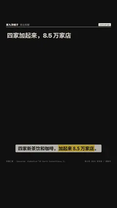

# `converge` · 

 

**怎么动**：

| 项 | 内容 |
|---|---|
| 类别 | 结构 |
| 适合的句子 | 多个来源汇成一个总数 |
| 建议时长 | 4.5–6 秒 |
| 参数 | `dec`, `sources`, `target`, `total`, `unit` |
| 横屏 / 竖屏 | ✓ / ✓（尺寸用 vmin，竖屏自动缩放） |
| 人气依据 | VideoHive「3D Earth Connections」3.4K · 「Infographic Maker」2.6K |

```json
{
 "scene": "fx",
 "fx": "converge",
 "theme": "ink",
 "topic": "商业拆解",
 "title": "四家加起来，8.5 万家店",
 "note": "截至 2024 年底",
 "sources": [
  [
   "蜜雪冰城",
   46479
  ],
  [
   "瑞幸咖啡",
   22340
  ],
  [
   "古茗",
   9914
  ],
  [
   "霸王茶姬",
   6440
  ]
 ],
 "target": "四家合计门店",
 "unit": "家",
 "line": "四家新茶饮和咖啡，*加起来 8.5 万家店*。",
 "src": "各公司 2024 年年报 / 招股书",
 "t": "@关键词"
}
```

**已知坑**：无
