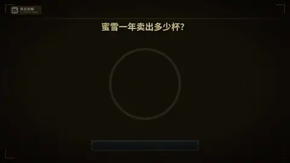

# `countdown` · 

 

**怎么动**：

| 项 | 内容 |
|---|---|
| 类别 | 结构 |
| 适合的句子 | 「给你 5 秒」、悬念、倒数 |
| 建议时长 | 每下 0.5–1 秒 |
| 参数 | `ask`, `from`, `question`, `reveal`, `to` |
| 横屏 / 竖屏 | ✓ / ✓（尺寸用 vmin，竖屏自动缩放） |
| 人气依据 | VideoHive Elements countdown 大类 · talkcraft countdown-arc-scatter |

```json
{
 "scene": "fx",
 "fx": "countdown",
 "theme": "lemon",
 "topic": "商业拆解",
 "host": true,
 "question": "蜜雪一年卖出多少杯？",
 "reveal": "约 90 亿杯",
 "line": "给你 *5 秒*：蜜雪一年卖出多少杯？",
 "src": "2024 年全年约数（媒体报道）",
 "from": 5,
 "to": 1,
 "t": "@关键词"
}
```

**已知坑**：问题用 question（label 是画廊页脚）。
