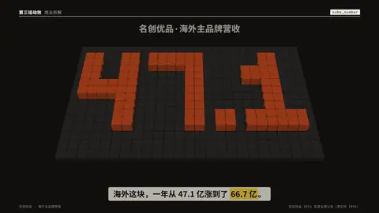
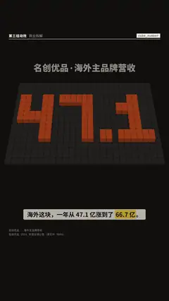

# `cube_number` · 方块落数

 

**怎么动**：一块地砖棋盘，正对着从前上方看（前倾 40°，竖屏约 920 px 宽、中心在 y 740），地砖比页面底色亮一档（深底）或暗一档（浅底），缝 2 px，方块落下前就看得出是棋盘。数字用方块字体搭成，每一笔都是 2 格粗，棋盘只按数字的宽度排格子，所以格子很大：属于数字的格子是强调色立方体（顶面强调色、正面暗 26%，落地处有一圈柔和的接触阴影）。单位（亿、万……）不做成方块，而是平面大字（竖屏 120 px）排在数字右端下方（横屏在棋盘右侧），最后一块落地时出现，从上方 600 px 处带重力加速落下，落地压扁再回弹（4 帧），从左到右一列一列落，整个数 1.2 秒搭完；其余格子是平的地砖。写了 `from` 时，棋盘先摆着旧数，旧方块穿过棋盘沉下去，新数的方块再落下来——是真实的变化，不编中间数。

| 项 | 内容 |
|---|---|
| 类别 | 数据 |
| 适合的句子 | 一个数从 A 变到 B、「一年从 47.1 亿涨到 66.7 亿」，要一块一块搭出来的分量感 |
| 建议时长 | 4–5 秒（有 `from` 时 5 秒） |
| 参数 | `value`（必填）、`from`（旧值，可选）、`label`（棋盘上方的标题）、`sub`（棋盘下方一行） |
| 横屏 / 竖屏 | ✓ / ✓（竖屏棋盘中心在 y 760，标题 56 px 在上、说明 36 px 在下；横屏占满页眉和字幕之间的高度） |
| 跟风格换皮 | 立方体用 --accent，地砖用 --card；风格的强调色和卡片色太接近时（如 `papercut`），棋盘自动换成更深的底色，方块始终看得清 |
| 什么时候用 | 规模、增长，要观众「看见」数字的体量 |
| 什么时候不用 | 小数位很多的精确值 |
| 同步口播 | 有 `from` 时，旧数停在拍长约 32% 处再换 |
| 缺内容 | 没写 `value` 会直接报错；确实要骨架时写 `"skeleton": true` |

```json
{
 "scene": "fx",
 "fx": "cube_number",
 "value": "66.7亿",
 "from": "47.1亿",
 "label": "名创优品 · 海外主品牌营收",
 "sub": "2023 → 2024 · 同比 +41.9%",
 "line": "海外这块，一年从 47.1 亿涨到了 *66.7 亿*。",
 "src": "名创优品 2024 年度业绩公告（港交所 9896）",
 "t": "@关键词"
}
```

**已知坑**：值必须以数字开头；数字和 . , % 做成方块，后面的部分（亿、万、家……）当单位排平面字。数字越长格子越小。方块从画面里落下，不会越出画面或越过页眉；`from` 和 `value` 单位相同时，单位一直留在原处。和 `mosaic_number`（真实作品图拼成数字）不同，这里的数字由方块搭成。

**实现**：`scripts/h9/fx/fx3_scene.py`。
