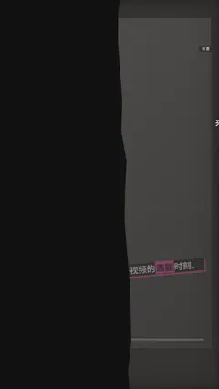

# `danmaku` · 

 

**怎么动**：

| 项 | 内容 |
|---|---|
| 类别 | 界面 |
| 适合的句子 | 弹幕刷屏、高能时刻 |
| 建议时长 | 2–3 秒 |
| 参数 | `bg`, `count`, `hl_text`, `items`, `mock`, `mock_label`, `seed`, `speed`, `t_hl` |
| 横屏 / 竖屏 | ✓ / ✓（尺寸用 vmin，竖屏自动缩放） |
| 人气依据 | B站弹幕刷屏 · 二创与口播常用 |

```json
{
 "scene": "fx",
 "fx": "danmaku",
 "theme": "ink",
 "topic": "做内容",
 "mock": true,
 "line": "弹幕刷屏的那一秒，就是这条视频的*高能*时刻。",
 "count": 34,
 "t_hl": 31.9,
 "items": [
  "来了来了",
  "前排",
  "4 块钱的柠檬水",
  "原来加盟商才是客户",
  "学到了",
  "关注了",
  {
   "text": "高能预警",
   "hl": true
  },
  "这期干货",
  "哈哈哈哈哈",
  "求更新",
  {
   "text": "终于有人讲透了",
   "hl": true
  },
  "收藏=学会",
  "所以它不怕便宜",
  "66666",
  "下期拆咖啡"
 ],
 "t": "@关键词"
}
```

**已知坑**：无
