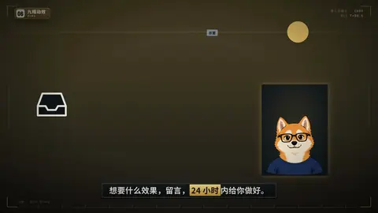

# `dial` · 仪表 / 时钟 · Dial

 

**怎么动**：gauge：240° 仪表刻度点亮，指针带一点过冲扫到数值，数值弧跟着填满，标签落在下面。clock：24 小时（或 12 / 60）表盘，指针走一圈、圆环跟着填满、中间数到 24h，然后「处理好 ✓」章砸下来。可以先掉下一个图标（收件箱等）并让一张便签落进去；可以配一块从白天变黑夜的天空面板。

**什么时候用**：gauge：兼容性、满意度、风险、完成度这类「程度」。clock：「24 小时内处理」「每天 8 小时」「一小时出片」这类「时长承诺」。

| 项 | 内容 |
|---|---|
| 类别 | 数字变形状 |
| 建议时长 | 4–6 秒 |
| 横屏 / 竖屏 | ✓ / ✓ |

**参数**

| 参数 | 说明 |
|---|---|
| `mode` | gauge | clock |
| `value / min / max` | 数值和量程（clock 默认 0–hours） |
| `unit` | 单位 |
| `text` | 表下面的标签 |
| `lo / hi` | gauge 两端的字 |
| `hours` | clock：24 | 12 | 60 |
| `stamp` | clock 结束时的章，默认「处理好 ✓」 |
| `icon` | 开场图标：inbox / mail / bug 或任意内置图标名、SVG path |
| `note` | 落进图标的便签 |
| `daynight` | true = 天空面板日→夜 |
| `show_value` | gauge 是否显示数字，默认 true |
| `subject / subject_label` | 主体小卡 |
| `mock` | 示意标签 |

```json
{
 "scene": "fx",
 "fx": "dial",
 "mode": "clock",
 "hours": 24,
 "value": 24,
 "icon": "inbox",
 "note": "想要的效果",
 "stamp": "处理好 ✓",
 "text": "反馈 24 小时内处理",
 "daynight": true,
 "subject": "../../assets/host.webm",
 "line": "想要什么效果，留言，*24 小时*内给你做好。",
 "t": "@关键词"
}
```

所有这一组效果（数字变形状）：颜色、字体、圆角、描边、阴影、入场缓动都取自当前风格（18 种风格自动换皮）；横竖屏同一套参数；可选 `subject`（图片或视频）把主讲人放在旁边的小卡里。

**风格改结构**：gauge 的造型随风格变——hud / screen 是细线表（密刻度 + 数字 + MIN/MAX/VAL 读数行）、poster / pixel 是实心扇形 + 方块指针、ink / sketch 是一笔毛刷弧 + 三个墨点，其余风格是标准粗弧。clock 的数字有底板、压在指针上面，指针不会扫过它；竖屏带主体时表盘约占 70% 宽，主体卡压在表盘右下角。

**已知坑**：标签参数叫 text（label 是页脚的效果名）。
