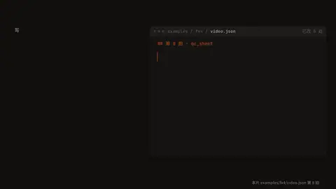
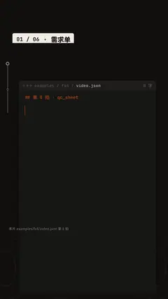

# `doc_edit` · 改稿窗口

 

**怎么动**：一个文档窗口（标题栏三个圆点 + 路径，下面一行二级标题），正文按顺序一个字一个字打出来，带光标；速度按内容自动调，所有行和修改都在拍长 80% 前完成，行多装不下时文档按光标所在行往上滚。打完后逐条修改：光标跳到 `from` 那段，一道删除线（风格的警示色）划过去、字变灰，`to` 接在后面打进来，带强调色底标记；那一段因为变长会重新换行，后面的段落跟着往下推。中文按字断行、英文按词断行，行首不放标点。
横屏：窗口在右（x 800–1810，y 150–890），左栏是正在做的动作——「写 / 删 / 改」三个大字（≥ 104 px）随动作依次亮起（强调色 + 下划线走完 → 打勾），下面是实时字数，标签在最下面。竖屏：动作做成三个小块一排放在最上面（y 300 起），标签一排在它下面，窗口占满宽（x 70–1010）从下面一直铺到画面底边之外，正文只排到字幕带上方；字数在标题栏右侧。窗口入场方向也不同（横屏从右滑入，竖屏从上落下）。没有修改时动作是「写 / 存」，结束时标题栏「未保存」变「已保存」。

| 项 | 内容 |
|---|---|
| 类别 | 流程 · 界面 / 工作流 |
| 适合的句子 | 「它按我的口吻写好稿子，我只改了两句」「先写，再删，再改」 |
| 建议时长 | 5–7 秒（行多时更长，打字速度会自己压缩） |
| 参数 | `lines`（必填，字符串列表，按顺序打出；也可写成 `\|` 分隔或多行字符串）、`edits`（`[{"line": 0, "from": "原文片段", "to": "改成"}]`，最多 4 条；`line` 越界取最近一行，`from` 找不到时整行划掉）、`path`（默认「草稿 / 口播稿.md」）、`heading`（默认「## 正文」，写空字符串不显示）、`tags`（窗口下的小标签，最多 4 个）、`kicker`（横屏左栏小字） |
| 横屏 / 竖屏 | ✓ / ✓（两套构图；1:1、4:5、3:4 用竖屏构图缩放） |
| 跟风格换皮 | 窗口用 --card / --card-fg / --k-r / --k-sh；删除线用风格警示色，插入用 --accent 底；动作大字用 --f-display |
| 什么时候用 | 讲「AI 写稿 / 人工改稿」的过程，要看见具体改了哪句 |
| 什么时候不用 | 要读完整篇长文（这是过程画面，不是阅读画面）；代码请用 `code` |
| 同步口播 | 打字从拍开头约 0.5 秒开始，改稿在后半段；拍越长打得越从容 |
| 缺内容 | 没写 `lines` 会直接报错；确实要骨架时写 `"skeleton": true` |

```json
{
 "scene": "fx",
 "fx": "doc_edit",
 "d": 6,
 "path": "示例频道 / ep21 / 口播稿.md",
 "lines": ["这条视频从头到尾，我一个剪辑师都没请。", "稿子是它按我的口吻写的，我只改了两句。", "配音是我自己的声音，字幕自动对齐。"],
 "edits": [{"line": 0, "from": "我一个剪辑师都没请", "to": "只有我和一台电脑"}, {"line": 1, "from": "两句", "to": "一句"}],
 "tags": ["按我的口吻写", "已改 2 处"],
 "line": "它先按我的口吻写稿，再改几句。"
}
```

**已知坑**：正文字号按内容在 34–48 px（横屏）/ 40–66 px（竖屏）之间自动选，最小不再缩，装不下就滚动；超过 60 行只打前 60 行。滚出窗口的行会隐藏。和 `typewriter`（单句打字）、`strike_fix`（一句话改口）不同，这里是一整份文档的写和改。

**实现**：`scripts/h9/fx/fx4_work.py`。
