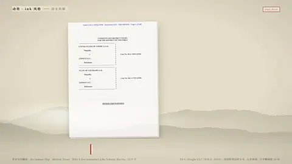

# `doc_flip` · 

 

**怎么动**：

| 项 | 内容 |
|---|---|
| 类别 | 文档 |
| 适合的句子 | 判决书、财报、长文档翻到某页 |
| 建议时长 | 5–6 秒 |
| 参数 | `caption`, `dpi`, `flips`, `hl`, `of`, `pdf`, `quote`, `range`, `target`, `title` |
| 横屏 / 竖屏 | ✓ / ✓（尺寸用 vmin，竖屏自动缩放） |
| 人气依据 | Motion Array「Edit A Documentary Like Johnny Harris」53.9 万 |

```json
{
 "scene": "fx",
 "fx": "doc_flip",
 "theme": "paper",
 "topic": "商业拆解",
 "pdf": "assets/us_v_google_2024_p1-24.pdf",
 "quote": "Google is a monopolist, and it has acted as one to maintain its monopoly",
 "title": "286 页里的一句话",
 "caption": "美国诉谷歌案判决书，2024 年 8 月 5 日",
 "line": "286 页的判决书，关键那句在*第 8 页*。",
 "src": "US v. Google LLC（D.D.C. 2024），美国联邦法院文书，公有领域；片中翻阅前 24 页",
 "of": 286,
 "t": "@关键词"
}
```

**已知坑**：PDF 是节选时用 `of` 写全文页数，否则计数器显示节选的页数。
