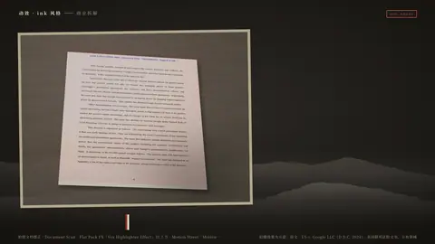
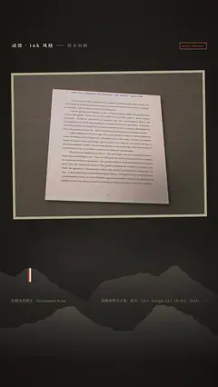

# `doc_photo` · 

 

**怎么动**：

| 项 | 内容 |
|---|---|
| 类别 | 文档 |
| 适合的句子 | 手机拍的文件 / 白板 / 截图证据 |
| 建议时长 | 4.5–5.5 秒 |
| 参数 | `caption`, `corners`, `hl`, `image`, `kicker`, `ratio`, `src`, `title` |
| 横屏 / 竖屏 | ✓ / ✓（尺寸用 vmin，竖屏自动缩放） |
| 人气依据 | Flat Pack FX「Vox Highlighter Effect」31.3 万 · Motion Street「Motion Graphics Like Vox」83.8 万 |

```json
{
 "scene": "fx",
 "fx": "doc_photo",
 "theme": "ink",
 "topic": "商业拆解",
 "image": "assets/photo_ruling.jpg",
 "corners": [
  [
   20.62,
   10.0
  ],
  [
   77.5,
   15.83
  ],
  [
   81.25,
   92.5
  ],
  [
   15.62,
   88.33
  ]
 ],
 "hl": [
  [
   42.5,
   12.9,
   46.56,
   2.42
  ],
  [
   11.44,
   16.39,
   10.97,
   2.42
  ]
 ],
 "title": "拍歪了也没关系",
 "caption": "自动找角、摆正、提亮，再划重点",
 "line": "手机拍的判决书歪了，*自动摆正*再划重点。",
 "src": "拍摄效果为示意；原文：US v. Google LLC（D.D.C. 2024），美国联邦法院文书，公有领域",
 "t": "@关键词"
}
```

**已知坑**：自动找角点是启发式（Otsu / Canny 找最大四边形）；背景杂乱时请手动给 corners。
