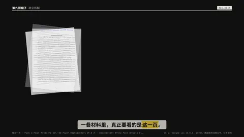
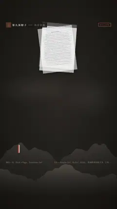

# `doc_pick` · 

 

**怎么动**：

| 项 | 内容 |
|---|---|
| 类别 | 文档 |
| 适合的句子 | 一叠材料里的关键一页 |
| 建议时长 | 4.5–5.5 秒 |
| 参数 | `caption`, `hl`, `pdf`, `pick`, `quote`, `tag`, `title` |
| 横屏 / 竖屏 | ✓ / ✓（尺寸用 vmin，竖屏自动缩放） |
| 人气依据 | Premiere Gal「3D Paper Highlighter」19.8 万 · Documentary Style Pack（Envato Elements 热门） |

```json
{
 "scene": "fx",
 "fx": "doc_pick",
 "theme": "ink",
 "topic": "商业拆解",
 "pdf": "assets/us_v_google_2024_p1-24.pdf",
 "range": [
  1,
  10
 ],
 "pick": 8,
 "quote": "Google is a monopolist, and it has acted as one to maintain its monopoly",
 "title": "一叠材料，只看这一页",
 "line": "一叠材料里，真正要看的是*这一页*。",
 "src": "US v. Google LLC（D.D.C. 2024），美国联邦法院文书，公有领域",
 "tag": "第 8 页",
 "t": "@关键词"
}
```

**已知坑**：无
