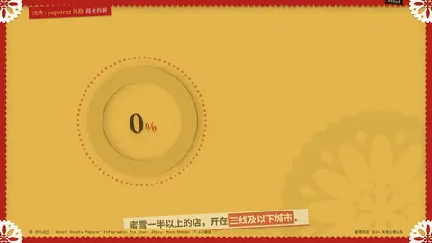
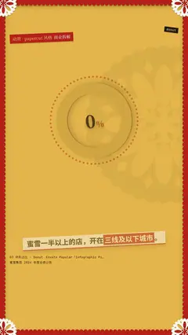

# `donut` · 

 

**怎么动**：

| 项 | 内容 |
|---|---|
| 类别 | 数据 |
| 适合的句子 | 占比、构成、「一半以上」 |
| 建议时长 | 2–3 秒 |
| 参数 | `center`, `dec`, `segments`, `sub`, `text`, `value` |
| 横屏 / 竖屏 | ✓ / ✓（尺寸用 vmin，竖屏自动缩放） |
| 人气依据 | Envato Popular「Infographic Pie Chart 250+」· Move Shapes 17.6万播放 |

```json
{
 "scene": "fx",
 "fx": "donut",
 "theme": "lemon",
 "topic": "商业拆解",
 "value": 57.4,
 "text": "开在三线及以下城市",
 "sub": "蜜雪冰城门店分布 · 截至 2024 年底",
 "line": "蜜雪一半以上的店，开在*三线及以下城市*。",
 "src": "蜜雪集团 2024 年度业绩公告",
 "t": "@关键词"
}
```

**已知坑**：segments 会按总和归一化，最多 6 段。
