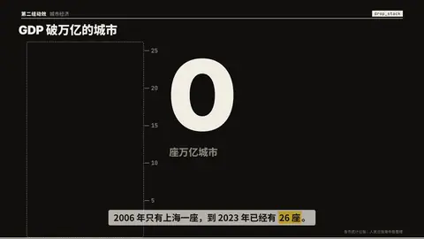
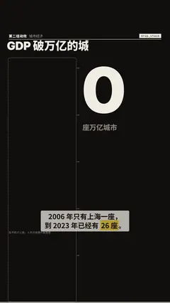

# `drop_stack` · 掉落堆叠

 

**怎么动**：一个一个掉下来：每个单位受重力下落、落地压扁、弹一下，叠成一根柱子，柱子高度就是这个数；每落一块计数器跳一下，旁边报出刚落下的是谁（items，跟着口播）。第一帧就有虚线框标出最终高度。

| 项 | 内容 |
|---|---|
| 类别 | 物理 |
| 适合的句子 | 「到 2023 年已经有 26 座」「一年开了 N 家」——一个可数的总数，最好还能点名每一个 |
| 建议时长 | 4–5 秒（单位越多越久） |
| 参数 | `value`（必填）、`items`（每块的名字，可选，最多一块一个）、`per`（一块代表多少，默认自动取 1/2/5×10ⁿ，最多 60 块）、`unit`、`title`、`note` |
| 横屏 / 竖屏 | ✓ / ✓（竖屏：柱子 424 宽贴左边、从底边长上来，计数器（数字高 ≥ 320 px）在右侧字幕带上方；横屏：柱子居左，计数器在右侧中间） |
| 跟风格换皮 | 颜色只用风格的 token（--bg --fg --muted --accent --card --card-fg），字体用风格的 display / body / num；没写 `theme` 时画在风格自己的底色上 |
| 什么时候用 | 数量本身就是重点、而且「一个一个攒出来」有意义（城市、门店、版本） |
| 什么时候不用 | 数值很大又没法拆成可数单位（如 248.3 亿元）——用 `pour_fill` 或 `zoom_scale`；占比用 `pour_fill` |
| 同步口播 | 有字级时间戳（meta.words）时，条目 / 关键时刻落在说到它的那一刻；`at` 可以写 `"@词"` 或拍内秒数 |
| 缺内容 | 必填参数缺了会直接报错（不会画空骨架）；确实要骨架时写 `"skeleton": true` |

```json
{
 "scene": "fx",
 "fx": "drop_stack",
 "topic": "城市经济",
 "title": "GDP 破万亿的城市",
 "value": 26,
 "unit": "座万亿城市",
 "items": [
  "上海 2006",
  "北京 2008",
  "广州 2010",
  "深圳 2011",
  "重庆 2011",
  "天津 2011",
  "苏州 2011",
  "成都 2014",
  "武汉 2014",
  "杭州 2015",
  "南京 2016",
  "青岛 2016",
  "无锡 2017",
  "长沙 2017",
  "宁波 2018",
  "郑州 2018",
  "佛山 2019",
  "泉州 2020",
  "济南 2020",
  "合肥 2020",
  "南通 2020",
  "西安 2020",
  "福州 2020",
  "东莞 2021",
  "常州 2023",
  "烟台 2023"
 ],
 "line": "2006 年只有上海一座，到 2023 年已经有 *26 座*。",
 "src": "各市统计公报；人民日报海外版整理",
 "t": "@关键词"
}
```

**已知坑**：单位超过 60 块会报错，要设 `per`；items 比单位多也会报错。
