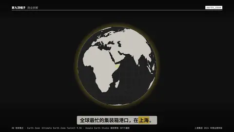
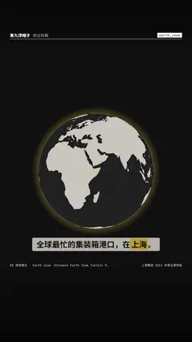

# `earth_zoom` · 

 

**怎么动**：

| 项 | 内容 |
|---|---|
| 类别 | 地图 |
| 适合的句子 | 地点揭晓、「在哪里」、开场定位 |
| 建议时长 | 3–4 秒 |
| 参数 | `from_lat`, `from_lon`, `km`, `lat`, `lon`, `sub`, `text`, `zoom` |
| 横屏 / 竖屏 | ✓ / ✓（尺寸用 vmin，竖屏自动缩放） |
| 人气依据 | Ultimate Earth Zoom Toolkit 9.5K · Google Earth Studio 缩放教程 207万播放 |

```json
{
 "scene": "fx",
 "fx": "earth_zoom",
 "theme": "ink",
 "topic": "商业拆解",
 "lon": 121.5,
 "lat": 31.2,
 "text": "上海",
 "sub": "2024 · 5150.6 万标箱",
 "line": "全球最忙的集装箱港口，在*上海*。",
 "src": "上港集团 2024 年度业绩快报",
 "t": "@关键词"
}
```

**已知坑**：只画陆地不画国界；需要国界时必须换中国视角数据并核对标准地图。d3 / topojson 走 jsdelivr，渲染机要能联网。
