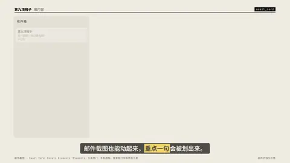
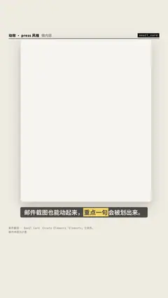

# `email_card` · 

 

**怎么动**：

| 项 | 内容 |
|---|---|
| 类别 | 文档 |
| 适合的句子 | 邮件证据、offer、通知邮件 |
| 建议时长 | 4.5–5.5 秒 |
| 参数 | `attachments`, `body`, `date`, `from`, `inbox`, `sender`, `stamp`, `subject`, `to` |
| 横屏 / 竖屏 | ✓ / ✓（尺寸用 vmin，竖屏自动缩放） |
| 人气依据 | Envato Elements「Elements」分类热门：手机通知、搜索框打字等界面元素 |

```json
{
 "scene": "fx",
 "fx": "email_card",
 "theme": "paper",
 "topic": "做内容",
 "sender": "示例频道 <hello@example.com>",
 "to": "你",
 "date": "2026-11-01 09:30",
 "subject": "来一起做一条口播视频？",
 "body": [
  "你好，看了你的选题，我们觉得很适合做成一条 30 秒的口播。",
  "*文案你来写，动效和配音交给九帽动效*，横屏竖屏各出一版。",
  "附件里是这一期的分镜草稿，有空看看。"
 ],
 "attachments": [
  "分镜草稿.pdf",
  "参考片.mp4"
 ],
 "stamp": "示意",
 "inbox": [
  {
   "sender": "示例频道",
   "subject": "来一起做一条口播视频？",
   "time": "09:30"
  },
  {
   "sender": "剪辑组",
   "subject": "第 12 期 · 粗剪已上传",
   "time": "昨天"
  },
  {
   "sender": "字幕校对",
   "subject": "错别字两处，已标黄",
   "time": "周四"
  }
 ],
 "line": "邮件截图也能动起来，*重点一句*会被划出来。",
 "src": "邮件内容为示意",
 "t": "@关键词"
}
```

**已知坑**：示例或虚构邮件必须带「示意」章；界面是中性的，不模仿任何真实邮箱产品。
