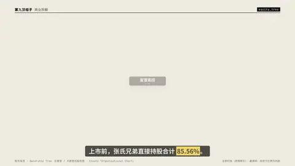

# `equity_tree` · 

 

**怎么动**：

| 项 | 内容 |
|---|---|
| 类别 | 人物 |
| 适合的句子 | 股权穿透、组织架构 |
| 建议时长 | 4–5 秒 |
| 参数 | `hl`, `holders`, `mock`, `mock_label`, `mode`, `root`, `subs`, `summary` |
| 横屏 / 竖屏 | ✓ / ✓（尺寸用 vmin，竖屏自动缩放） |
| 人气依据 | 企查查 / 天眼查式股权图 · Envato「Organizational Chart」 |

```json
{
 "scene": "fx",
 "fx": "equity_tree",
 "theme": "paper",
 "topic": "商业拆解",
 "line": "上市前，张氏兄弟直接持股合计 *85.56%*。",
 "src": "证券时报（虎嗅转引）· 赢商网；投资方比例为约数",
 "root": {
  "name": "蜜雪集团",
  "note": "上市前"
 },
 "holders": [
  {
   "name": "张红超",
   "pct": "42.78",
   "kind": "person"
  },
  {
   "name": "张红甫",
   "pct": "42.78",
   "kind": "person"
  },
  {
   "name": "美团龙珠",
   "pct": "4",
   "kind": "org"
  },
  {
   "name": "高瓴",
   "pct": "4",
   "kind": "org"
  },
  {
   "name": "CPE 源峰",
   "pct": "2",
   "kind": "org"
  }
 ],
 "subs": [
  {
   "name": "蜜雪冰城",
   "note": "茶饮品牌",
   "kind": "org"
  },
  {
   "name": "幸运咖",
   "note": "咖啡品牌",
   "kind": "org"
  },
  {
   "name": "五大生产基地",
   "note": "自有供应链",
   "kind": "org"
  }
 ],
 "hl": [
  "张红超",
  "张红甫"
 ],
 "summary": "兄弟合计 85.56%",
 "t": "@关键词"
}
```

**已知坑**：无
