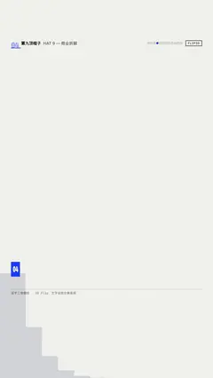

# `flip3d` · 逐字三维翻转 (3D Flip per character)

 

**怎么动**：rotateX from -100°, transform-origin bottom, perspective on the line.

| 项 | 内容 |
|---|---|
| 类别 | 字效 |
| 适合的句子 | 账号名、章节名 |
| 建议时长 | 2–3 秒 |
| 参数 | `text` |
| 横屏 / 竖屏 | ✓ / ✓（尺寸用 vmin，竖屏自动缩放） |
| 人气依据 | 文字动效合集高频 |

```json
{
 "scene": "fx",
 "fx": "flip3d",
 "theme": "lemon",
 "topic": "商业拆解",
 "text": "第二章 · 供应链",
 "line": "第二部分，我们看它的*供应链*。",
 "t": "@关键词"
}
```

**已知坑**：无
