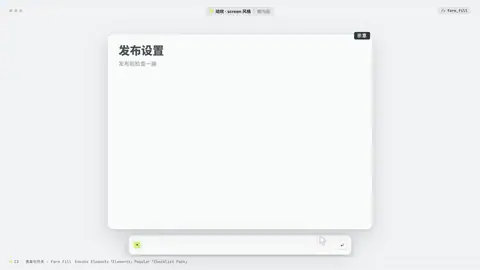
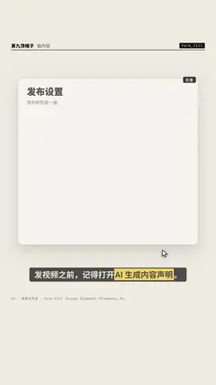

# `form_fill` · 

 

**怎么动**：

| 项 | 内容 |
|---|---|
| 类别 | 界面 |
| 适合的句子 | 「发布前要勾选什么」「这个设置一定要打开」 |
| 建议时长 | 每个字段 0.6–1 秒 + 按钮 1.4 秒 |
| 参数 | `cursor`, `done`, `fields`, `sub`, `submit`, `title` |
| 横屏 / 竖屏 | ✓ / ✓（尺寸用 vmin，竖屏自动缩放） |
| 人气依据 | Envato Elements「Elements」Popular「Checklist Pack」 |

```json
{
 "scene": "fx",
 "fx": "form_fill",
 "theme": "paper",
 "topic": "做内容",
 "line": "发视频之前，记得打开*AI 生成内容声明*。",
 "title": "发布设置",
 "sub": "发布前检查一遍",
 "fields": [
  {
   "label": "标题",
   "value": "一杯 4 块钱的柠檬水",
   "kind": "text"
  },
  {
   "label": "内容由 AI 生成",
   "kind": "toggle",
   "on": true,
   "note": "平台要求标注"
  },
  {
   "label": "封面比例",
   "kind": "select",
   "value": "3:4",
   "options": [
    "16:9",
    "4:3",
    "3:4"
   ]
  },
  {
   "label": "同步到小红书",
   "kind": "check",
   "on": true
  }
 ],
 "submit": "发布",
 "done": "已提交审核",
 "mock": true,
 "t": "@关键词"
}
```

**已知坑**：字段超过 6 个请给 6 秒以上；AI 声明这类开关用 toggle + note 写明平台要求。
