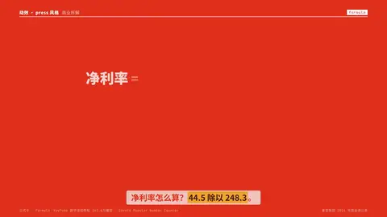

# `formula` · 

 

**怎么动**：

| 项 | 内容 |
|---|---|
| 类别 | 数据 |
| 适合的句子 | 一个比率怎么算出来 |
| 建议时长 | 3.5–4.5 秒 |
| 参数 | `dec`, `lhs`, `note`, `ops`, `result`, `terms`, `unit` |
| 横屏 / 竖屏 | ✓ / ✓（尺寸用 vmin，竖屏自动缩放） |
| 人气依据 | YouTube 数字滚动教程 162.6万播放 · Envato Popular Number Counter |

```json
{
 "scene": "fx",
 "fx": "formula",
 "theme": "red",
 "topic": "商业拆解",
 "lhs": "净利率",
 "terms": [
  [
   "净利润",
   "44.5 亿"
  ],
  [
   "营业收入",
   "248.3 亿"
  ]
 ],
 "ops": [
  "÷"
 ],
 "result": "17.9%",
 "note": "蜜雪集团 2024 年",
 "line": "净利率怎么算？*44.5 除以 248.3*。",
 "src": "蜜雪集团 2024 年度业绩公告",
 "t": "@关键词"
}
```

**已知坑**：无
