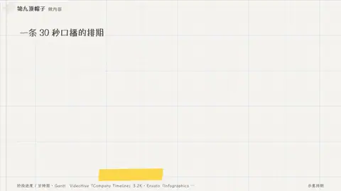

# `gantt` · 

 

**怎么动**：

| 项 | 内容 |
|---|---|
| 类别 | 数据 |
| 适合的句子 | 排期、阶段、并行任务 |
| 建议时长 | 4.5–6 秒 |
| 参数 | `hi`, `hl`, `lo`, `milestones`, `now`, `tasks`, `unit` |
| 横屏 / 竖屏 | ✓ / ✓（尺寸用 vmin，竖屏自动缩放） |
| 人气依据 | VideoHive「Company Timeline」3.2K · Envato「Infographics 6 Roadmaps」 |

```json
{
 "scene": "fx",
 "fx": "gantt",
 "theme": "paper",
 "topic": "做内容",
 "title": "一条 30 秒口播的排期",
 "note": "示意 · 单位：小时",
 "tasks": [
  [
   "选题与查证",
   0,
   2
  ],
  [
   "写稿",
   1.5,
   3
  ],
  [
   "配音",
   3,
   3.5
  ],
  [
   "分镜",
   3,
   4.5
  ],
  [
   "渲染与检查",
   4.5,
   5
  ],
  [
   "发布",
   5,
   5.2
  ]
 ],
 "unit": "h",
 "milestones": [
  [
   "定稿",
   3
  ],
  [
   "交付",
   5.2
  ]
 ],
 "now": 3.8,
 "hl": 3,
 "mock": "示意",
 "line": "写稿和查证可以*并行*，分镜要等配音出来。",
 "src": "示意排期",
 "t": "@关键词"
}
```

**已知坑**：无
