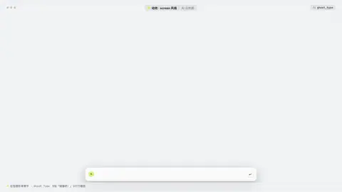
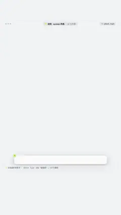

# `ghost_type` · 巨型虚影背景字 (Ghost / outline background type)

 

**怎么动**：a huge outlined word drifts behind small foreground copy.

| 项 | 内容 |
|---|---|
| 类别 | 字效 |
| 适合的句子 | 章节标题 + 小字说明 |
| 建议时长 | 2–3 秒 |
| 参数 | `ghost`, `sub`, `text` |
| 横屏 / 竖屏 | ✓ / ✓（尺寸用 vmin，竖屏自动缩放） |
| 人气依据 | B站「碰撞吧！」107万播放 |

```json
{
 "scene": "fx",
 "fx": "ghost_type",
 "theme": "paper",
 "topic": "AI 与判断",
 "ghost": "对比",
 "text": "同一个模型",
 "sub": "same model · same prompt",
 "line": "同一个模型，同样的提示词，*结果完全不同*。",
 "t": "@关键词"
}
```

**已知坑**：虚影字是故意半透明的，check 时已标记为允许重叠。
