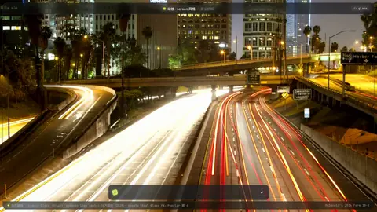
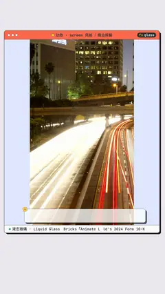

# `glass` · 

 

**怎么动**：

| 项 | 内容 |
|---|---|
| 类别 | 界面 |
| 适合的句子 | 一个核心数字浮在实拍上 |
| 建议时长 | 2–3 秒 |
| 参数 | `compact`, `dec`, `image`, `kicker`, `rows`, `tag`, `text`, `unit`, `value`, `value_text`, `video`, `video_start` |
| 横屏 / 竖屏 | ✓ / ✓（尺寸用 vmin，竖屏自动缩放） |
| 人气依据 | Bricks「Animate Like Apple」76万播放（2025）· Envato「Real Glass FX」Popular 第 4 |

```json
{
 "scene": "fx",
 "fx": "glass",
 "theme": "ink",
 "topic": "商业拆解",
 "image": "assets/broll/trails.jpg",
 "kicker": "MCDONALD'S · 2024",
 "tag": "10-K",
 "value": 95,
 "unit": "%",
 "text": "的麦当劳餐厅是加盟店",
 "line": "麦当劳全球的餐厅，*95%* 是加盟店。",
 "src": "McDonald's 2024 Form 10-K",
 "t": "@关键词"
}
```

**已知坑**：用视频做背景时卡片的模糊依赖 backdrop-filter，渲染里已验证有效。
