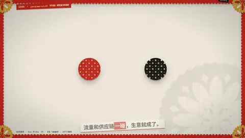

# `gooey` · 粘性碰撞 (gooey metaballs)

 

**怎么动**：two balls approach, merge with a liquid neck, bounce apart; squash & stretch. labels: optional [左, 右] — two words that ride under the balls (e.g. 流量 / 供应链).

| 项 | 内容 |
|---|---|
| 类别 | 图形 |
| 适合的句子 | 合并、碰撞、两者关系 |
| 建议时长 | 2–3 秒 |
| 参数 | `labels` |
| 横屏 / 竖屏 | ✓ / ✓（尺寸用 vmin，竖屏自动缩放） |
| 人气依据 | S5 · B站「碰撞吧！」107万播放 |

```json
{
 "scene": "fx",
 "fx": "gooey",
 "theme": "paper",
 "topic": "商业拆解",
 "line": "流量和供应链*一碰*，生意就成了。",
 "t": "@关键词"
}
```

**已知坑**：无
